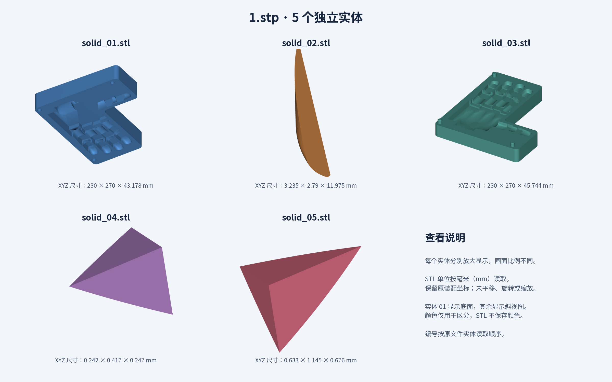

# 1.stp 的 5 个独立 STL

源文件：`../1.stp`。按 CAD 读取的实体顺序编号；每个 STL 对应一个源实体。

**坐标数值单位为毫米（mm）**。STL 格式不包含单位元数据，导入时请选择毫米。保留原装配位置、方向和尺寸，未重新居中。

预览中每个实体独立放大，不能按画面大小比较实际尺寸；识别颜色不保存到 STL。

| 文件 | XYZ 尺寸（mm） | 三角面数 | 网格闭合检查 |
| --- | --- | ---: | --- |
| [solid_01.stl](solid_01.stl) | 230 × 270 × 43.178 | 92106 | 通过 |
| [solid_02.stl](solid_02.stl) | 3.235 × 2.79 × 11.975 | 3004 | 通过 |
| [solid_03.stl](solid_03.stl) | 230 × 270 × 45.744 | 121311 | 存在局部开边 |
| [solid_04.stl](solid_04.stl) | 0.242 × 0.417 × 0.247 | 72 | 通过 |
| [solid_05.stl](solid_05.stl) | 0.633 × 1.145 × 0.676 | 190 | 通过 |

5 个源 CAD 实体均通过有效性检查。第 3 个实体的 STL 有 13 条边界边及 2 条非流形边；提高离散精度后仍未消除。本次保留直接导出结果，可用于查看，未做封孔、布尔融合或几何修补。其余 4 个 STL 均为单个闭合连通网格。

仅拆出实体，不把原文件中额外的独立曲面壳混入这 5 个 STL。原始 `1.stp` 保持不变。

完整坐标范围、网格参数、体积、SHA256 和检查结果见 [manifest.json](manifest.json)。
