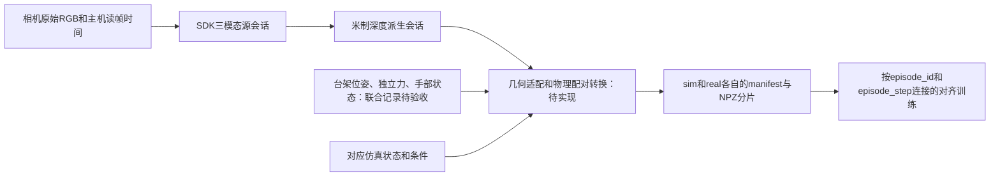

# 仿真—真机对齐训练：真机采集数据接口

核对日期：2026-10-11。仓库：`mulyi-model-tac`，分支 `main`，HEAD `94e93709b85883adecc1e23d7e45c16ae03c3886`。
本文按**当前工作区源码**编写，包括本轮目录整理后的路径。历史会话用于说明已有输出，不代表本次重新采集。

本接口服务于 RGB／Depth／Marker 表示学习及 sim–real latent 对齐。当前已经实现相机短采、空载参考复用、
SDK离线三模态推理和经单位链检查的米制深度派生；**从真实受控加载到可用于对齐训练的正式数据集，仍缺联合记录、几何适配和可信配对转换。**
本文中的“已实现”“历史数据”“待实现约定”分别标注，不能把约定字段当成当前脚本已经输出的字段。

ROS 台架已新增软件适配入口，见第14节；本次只通过离线契约测试，真实物理标定与配对验收仍待完成。

## 阅读导航

- [1. 数据链与实现边界](#1-数据链与实现边界)
- [2. 环境与调用接口](#2-环境与调用接口)
- [3. 原始相机接口](#3-原始相机接口)
- [4. SDK三模态与会话接口](#4-sdk三模态与会话接口)
- [5. 深度单位派生接口](#5-深度单位派生接口)
- [6. 手部、台架与测力接入](#6-手部台架与测力接入)
- [7. 几何、时间与参考约定](#7-几何时间与参考约定)
- [8. 训练数据集接口](#8-训练数据集接口)
- [9. sim–real配对与划分](#9-simreal配对与划分)
- [10. 待实现的联合记录与转换契约](#10-待实现的联合记录与转换契约)
- [11. 失败处理与验收](#11-失败处理与验收)
- [12. 历史样本与当前缺口](#12-历史样本与当前缺口)
- [13. 源码依据](#13-源码依据)
- [14. ROS台架软件适配](#14-ros台架软件适配)

## 1. 数据链与实现边界



| 层级 | 文件契约／入口 | 实现状态 | 可直接喂当前训练器 |
| --- | --- | --- | --- |
| 原始相机 | `raw/<SN>/frames.npz`、`camera.json` | 已实现 | 否 |
| 原生三模态 | `revo3_native_trimodal_source_v1`、`derived/<SN>/samples.npz` | 已实现 | 否 |
| 米制深度派生 | `revo3_metric_depth_derivative_v1`、`<SN>/samples.npz` | 已实现；保留原生字段 | 否 |
| 联合事件／几何／物理配对 | 相机＋台架＋测力＋手状态＋仿真对应记录 | 本项目联合适配尚未验收 | 否 |
| 训练数据集 | `manifest.json`＋`shards/*.npz`，12个必需字段 | 仿真采集／加载器已实现；ROS转换软件入口见第14节，真机验收待完成 | 契约和物理验收通过后才可 |

`session.json.status=complete`只表示该层处理完成，不等于训练manifest完成。
当前两种真实会话都保持 `training_ready=false`、`pair_valid=false`、`physical_calibration_validated=false`。
这些标记不是现有训练加载器的准入检查，正式转换必须在训练前另行验收。

## 2. 环境与调用接口

### 2.1 环境和边界

所有命令从仓库根目录执行。现用SDK解释器是
`/home/liuxinyu/workspace/brainco-revo3-sdk/.venv/bin/python`；
本仓库副本路径是 `calibration/vendor/brainco-revo3-sdk/runtime/python`。
副本对应 `bc-revo3-sdk 2.1.0`、`pyvitaisdk 1.0.17`；原生包／模型与解释器依赖均须实际存在。
`hardware/probe_local.sh`支持 `REVO3_PYTHON`，其他Python脚本使用启动它们的解释器及其 `sys.executable`。

| 入口 | 职责 | 副作用 |
| --- | --- | --- |
| `hardware/probe_local.sh` → `probe_revo3_readonly.py` | 手部状态／触觉及相机通路短测 | 正常运行打开RS485和相机，写新目录；不下发运动／清零／参数写入 |
| `hardware/collect_real_trimodal.py` | 相机原始短采＋SDK推理＋源会话打包 | 打开相机；不读取手串口、台架位姿或独立力，不控制运动 |
| `hardware/probe_revo3_trimodal.py` | 从已录RGB离线推理 | 不打开相机；新写派生目录 |
| `hardware/convert_revo3_depth_units.py` | SDK单位链检查、逐源帧重放、米制深度派生 | 不打开相机；检查通过后写新派生目录 |

本文提供调用示例，**本次文档生成没有运行这些采集、转换或训练命令**。
这里四个Python入口的 `--help` 均在参数解析阶段退出；不要据此推断其他Isaac入口的help也无副作用。

### 2.2 原生三模态采集CLI

入口：[collect_real_trimodal.py](../hardware/collect_real_trimodal.py)，函数 `collect_real_trimodal()`。

| 参数 | 类型／默认值 | 约束与语义 |
| --- | --- | --- |
| `--output` | 路径；必填 | 新会话目录必须不存在；内部转为绝对路径 |
| `--phase` | `baseline`／`loaded`；必填 | 此处是会话类别，不是训练样本的整数phase编码 |
| `--confirm-unloaded` | 开关 | baseline必须传；loaded禁止传；表示人工确认，脚本不检测外力 |
| `--reference-session` | 路径 | loaded必须传完整空载源会话；baseline禁止传；不是米制派生目录 |
| `--frames` | int；16 | 每路保留2–60帧，另有5帧预热丢弃 |
| `--serial` | 可重复字符串 | 显式选相机SN；重复、缺失SN拒绝；不传时要求正好5路 |
| `--finger-map` | JSON路径；可省略 | 已核实的SN→手指映射；值限 `little/ring/middle/index/thumb`，各值不得重复 |

相机通过 `/dev/v4l/by-id/*ViTai-GFBC*-video-index0`发现，使用稳定SN分目录，不以 `/dev/videoN`推断手指。
未提供映射的相机保持 `physical_finger=null`；不得按照枚举顺序或产品型号补指名。
加载采集会检查参考会话的 `phase=baseline`、`reference_state=unloaded-confirmed`、`status=complete`、
同SN的原始NPZ完整SHA256，以及已有手指映射的冲突。

```bash
# 先实际确认当前未受外力；写新目录，正常运行会打开相机。
OPENBLAS_NUM_THREADS=1 OMP_NUM_THREADS=1 \
  /home/liuxinyu/workspace/brainco-revo3-sdk/.venv/bin/python \
  calibration/hardware/collect_real_trimodal.py \
  --phase baseline --confirm-unloaded --frames 16 \
  --output calibration/captures/NEW_BASELINE

# 相同SN复用空载参考；此命令不会驱动台架加载。
# CAMERA_SN须换为已核实的实际SN，NEW_LOADED须不存在。
OPENBLAS_NUM_THREADS=1 OMP_NUM_THREADS=1 \
  /home/liuxinyu/workspace/brainco-revo3-sdk/.venv/bin/python \
  calibration/hardware/collect_real_trimodal.py \
  --phase loaded --reference-session calibration/captures/NEW_BASELINE \
  --serial CAMERA_SN --frames 16 --output calibration/captures/NEW_LOADED
```

同一相机不能同时由该脚本和ROS台架相机采集节点占用。
`--phase loaded`只是对当次采样场景的声明，不会提供目标力、接触零点或加载状态的独立测量。

## 3. 原始相机接口

相机worker是 [probe_revo3_readonly.py](../hardware/probe_revo3_readonly.py) 的 `revo3_camera_read_worker()`。
请求640×480、30 FPS、MJPG，设置单帧缓冲；实际协商参数写在 `camera.json.negotiated`。
每路预热5帧后保存M帧；不能将请求FPS当成实际曝光频率。

```text
<源会话>/
├── session.json
├── inference.log
├── raw/
│   ├── report.json
│   ├── <SN>.log
│   └── <SN>/
│       ├── camera.json
│       ├── frames.npz
│       └── last_frame.png
└── derived/                 # 第4节
```

### 3.1 `frames.npz`

所有NPZ用 `np.load(path, allow_pickle=False)`读取。M为保留原帧数；Hr/Wr为实际原始图尺寸。

| 字段 | dtype | 数组形状 | 语义／单位 |
| --- | --- | --- | --- |
| `rgb` | uint8 | `[M,Hr,Wr,3]` | RGB、HWC、0–255；OpenCV读入的BGR已转换 |
| `host_read_start_monotonic_ns` | int64 | `[M]` | 调用 `cap.read()` 前的主机单调时钟，ns |
| `host_read_end_monotonic_ns` | int64 | `[M]` | `cap.read()` 返回后的主机单调时钟，ns |
| `host_read_end_unix_ns` | int64 | `[M]` | 返回后记录的Unix墙钟，ns |

这些时间描述主机读帧窗口，**不是硬件曝光时间**；缓冲、传输和解码延迟未被消除。
多路相机逐路完成采样，没有共同硬件触发。

### 3.2 `camera.json` 和原始报告

核心字段为 `serial/by_id/device/finger/requested/negotiated/color_order_npz/timestamp_source/frames/shape/dtype/errors/passed`。
还记录像素范围、标准差、不同帧哈希数和短样本主机完成FPS；这些是诊断信息，不是物理质量验收。
相机worker的 `finger` 保持null；高层会话的已核实映射另外放在 `session.json.cameras[].physical_finger`。

高层采集生成的 `raw/report.json`只聚合相机记录，不含手部状态。
完整只读probe自己的 `report.json`还包含hand／finder workers、版本、返回码和通路验收范围，
两者虽然都叫report，不能混为同一业务会话。

## 4. SDK三模态与会话接口

### 4.1 帧和参考关系

离线worker来自 [probe_revo3_trimodal.py](../hardware/probe_revo3_trimodal.py)，函数 `trimodal_infer_worker()`。
根据SN检测GFBCI／GFBCT；保存工厂profile、实际profile、warp参数、模型哈希和处理器类型。
SDK接收BGR，原始 `rgb` 始终保存源RGB；`warped_bgr` 保留SDK BGR输出。
`reference.npz`保存实际使用的参考图，SDK `calibrate()` 是此处的参考图初始化，不是台架外参或响应精度标定。

| 场景 | 参考图 | 源帧索引 | 派生样本数N |
| --- | --- | --- | --- |
| baseline／无外部参考 | 当前raw同SN的第0帧 | `1..M-1` | `M-1` |
| loaded／指定外部参考 | 空载会话raw同SN的第0帧 | `0..M-1` | `M` |

因此每路16帧的baseline产生15个样本；loaded复用参考时产生16个样本。
五路baseline合计75组，不是80组；各路参考图独立。
低层工具只核对SN／格式／尺寸，高层采集入口才负责完整空载会话和原始哈希检查。

### 4.2 `derived/<SN>/` 文件

| 文件 | 内容 |
| --- | --- |
| `reference.npz` | `rgb`参考原图 `[Hr,Wr,3]` 和SDK参考 `warped_bgr`；无样本批维 |
| `reference_rgb.png` | 高层打包器生成的原参考RGB预览 |
| `trimodal.npz` | SDK原始结果、对应源RGB、源帧号和时间 |
| `inference.json` | profile／warp、数组shape／dtype／范围、源／参考／模型SHA256、errors／passed |
| `samples.npz` | 高层转换为CHW布局的原生源样本，仍非训练分片 |

`trimodal.npz`有 `raw_bgr/warped_bgr/depth/marker_origin/marker_current/marker_offset/rgb/source_frame_index`、
三项 `host_read_*` 以及 `[N,2]` 的 `inference_start_end_monotonic_ns`。
SDK Marker原始网格在已存会话中为 `[N,20,20,2]`；具体dtype以inference记录为准，
高层按行优先展开成400点，再将起点／位移转换为float32。

worker要求SDK数组非空、数值有限、RAW_IMG与输入BGR精确一致，depth为二维、marker末维为2；
`marker_offset_equals_current_minus_origin`另外作为报告项保存，不是单凭 `passed`可替代的物理跟踪验收。

### 4.3 `samples.npz` 完整字段

下表shape包含样本批维。Hd/Wd为该相机SDK输出图尺寸；K为SDK点数，已有会话K=400。

| 字段 | dtype | 形状 | 语义 |
| --- | --- | --- | --- |
| `rgb` | uint8 | `[N,3,Hr,Wr]` | 原始RGB，CHW；已有会话为480×640 |
| `rgb_warped` | uint8 | `[N,3,Hd,Wd]`（已有输出） | SDK warped BGR交换通道后的RGB；空间几何以profile核对 |
| `depth_sdk` | float32 | `[N,1,Hd,Wd]` | SDK原生深度数值；未在源会话中冒充 `depth_m` |
| `marker_2d` | float32 | `[N,K,5]` | `[x0,y0,dx,dy,finite]`，SDK图像像素坐标 |
| `marker_finite` | bool | `[N,K]` | 起点和位移均为有限数；不是置信度／真实marker身份 |
| `source_frame_index` | int64 | `[N]` | 回溯本会话raw RGB的帧索引 |
| `source_episode_id` | int64 | `[N]` | 每相机产生一个随机63位源回合ID，整路样本相同 |
| `episode_step` | int64 | `[N]` | 派生样本顺序 `0..N-1`，不是跨域共同时间 |
| `pair_valid` | bool | `[N]` | 当前全部false；没有生成可信仿真对应 |
| `unloaded_confirmed` | bool | `[N]` | baseline为true，loaded为false |
| 三项 `host_read_*` | int64 | `[N]` | 对应所选源帧的主机读帧时间，字段名同第3节 |

`source_episode_id`与 `session_id` 的含义不同：前者是每路随机整数，后者是整个会话UUID。
它们都不是训练所需的两域规范配对键。`samples.npz`不保存 `marker_current` 或推理开始／结束时间，
这些可继续从 `trimodal.npz`回溯。

### 4.4 `session.json`

| 字段 | 类型／含义 |
| --- | --- |
| `schema` | 固定 `revo3_native_trimodal_source_v1` |
| `session_id` | 当前源会话UUID |
| `status` | `collecting`→`complete`，异常时 `failed` |
| `phase` | `baseline`／`loaded` |
| `reference_state` | 当前入口写 `unloaded-confirmed`，描述参考状态；loaded样本仍可受载 |
| `reference_confirmation` | 人工确认来源文本，不是力传感器判定 |
| `reference_session_id/reference_session` | 空载参考UUID／绝对路径；baseline指向自身 |
| `started_utc/finished_utc` | ISO UTC字符串；查看时可换算Asia/Shanghai，不替代样本时间 |
| `sample_count` | 已打包的各相机样本数之和 |
| `training_ready/pair_valid/physical_calibration_validated` | 当前均false |
| `sampling/marker_layout/units/paired_training_key` | 逐路采样、Marker布局、原生单位及将来配对说明 |
| `script_sha256` | 高层采集脚本当前字节SHA256 |
| `conversion_blockers` | 深度／映射／点几何／配对待转换说明；该文本未动态感知另生成的米制派生 |
| `cameras[]` | 每路serial、physical_finger、sample_count、file、raw／reference／sample SHA256及schema |

`cameras[].schema[field] = {dtype, sample_shape}` 的 `sample_shape` **不含N**。
`file`是相对源会话根的 `derived/<SN>/samples.npz`。
`raw_sha256`、`reference_sha256`是整个原始 `frames.npz`文件哈希，`sample_sha256`是整个打包文件哈希，
不是第0帧的像素哈希。

## 5. 深度单位派生接口

入口：[convert_revo3_depth_units.py](../hardware/convert_revo3_depth_units.py)。
参数只有必填 `--source` 和 `--output`；source必须是完整原生源会话，output必须不存在。

```bash
# 离线读取已保存RGB并重放SDK；不打开设备，写新派生目录。
OPENBLAS_NUM_THREADS=1 OMP_NUM_THREADS=1 \
  /home/liuxinyu/workspace/brainco-revo3-sdk/.venv/bin/python \
  calibration/hardware/convert_revo3_depth_units.py \
  --source calibration/captures/NEW_BASELINE \
  --output calibration/captures/NEW_BASELINE_METRIC
```

当前固定单位链是：

```text
depth_m = float32(depth_sdk) × (1.2 / 200) = depth_sdk × 0.006
API上限1对应0.006 m；depth_saturated = depth_sdk >= 1
```

它是针对当前SDK／profile的**软件单位链验证**。转换前检查GFBCI／GFBCT、模型哈希、
胶体profile25×25×4 mm、解析曲面的postprocessor误差、API归一化／裁剪和每个源帧深度重放一致性。
`depth_to_metres()`只接受有限浮点、范围 `[0,1]` 的输入，输出float32。
不要把常数直接推广到其他SDK版本或产品。

```text
<米制派生>/
├── session.json              # revo3_metric_depth_derivative_v1
├── unit_verification.json
└── <SN>/samples.npz          # 保留源samples全部字段，另加以下两项
```

| 新字段 | dtype／shape | 含义 |
| --- | --- | --- |
| `depth_m` | float32，与depth_sdk相同 | m；尺寸／ROI没有变化 |
| `depth_saturated` | bool，与depth_sdk相同 | API达到上限的像素标记；当前训练加载器不会读取此mask |

派生 `session.json`记录源会话路径及SHA256、转换脚本SHA256、单位、`metres_per_sdk_unit`、
每路源／输出文件哈希、深度范围和饱和像素数；不复制源会话的 `phase/reference_session_id`等全部字段，
需要沿 `source_session`回溯。`unit_verification.json`记录SDK二进制／模型证据和逐路重放结果。
原始 `depth_sdk`和所有源文件保持；派生仍为 `training_ready=false/pair_valid=false`。
`physical_accuracy_validated=false`表示未通过真实压入量／独立测量的精度验收。

## 6. 手部、台架与测力接入

详细控制字段和停止语义的维护入口是[hardware/README.md](../hardware/README.md#标定台-ros-2-接口)。
本节只补充对训练数据记录的要求；没有实现新控制器，也不表示已完成联合采集。

### 6.1 手部状态／阵列

独立只读probe的 `revo3_hand_read_worker()`通过Modbus、5 Mbps、默认slave127读取3轮
`hand.state.snapshot()`和 `hand.touch.snapshot()`，保存设备／固件／joint_layout／touch_layout、
健康信息、启用mask、read mode、value mode、模块 `sample_state`和收到的点数。
输出为 `hand.json`的SDK对象属性序列化，`state`和 `touch`各有独立主机起止时间，不是同刻反馈。

正式联合记录应保留关节名称、顺序、单位、反馈、module_id、layout_id、点索引、有效性和原始值模式。
不要仅按21维长度推断SDK关节↔URDF关节兼容；模块不可用不等于数值0；
历史阵列布局和旧285-taxel接口需要各自几何映射。当前 `collect_real_trimodal.py`不会生成这些手状态。

### 6.2 台架ROS 2数据面

以下来自本机 `ros_ws/src/py_force_ws/py_force_interfaces/`，不依赖新增字段猜测。

| 通道 | 当前字段 | 保存方式与限制 |
| --- | --- | --- |
| `/force_data` · ForceData | int64 timestamp_ns；float32 fx/fy/fz/mx/my/mz | 力N、力矩N·m，六维原值都保留；当前控制压缩力 `max(0,-fz)`需标明传感器轴系 |
| `/axis_state` · AxisState | axis、position_pulses、position_mm、moving、fault、status | mm／脉冲；消息无时间戳，采集端另记接收时间 |
| `/multi_axis_state` · MultiAxisState | x/y/z三份AxisState、force_locked、active_action | 各轴最后缓存位置，不保证同刻采样 |
| `/turntable_state` · TurntableState | table、position_pulses、position_deg、moving、homed、fault、status | deg／脉冲；消息无时间戳，table取1／2，轴系外参待核实 |
| `/axis_query`、`/turntable_query` | success、位置、status | 保存请求起止时刻；失败返回的默认0不得视作实测位置 |

`ForceData.timestamp_ns`来自节点解析TCP报文时的ROS时钟：`get_clock().now()`，不是传感器硬件时钟。
接收方还应保存自身单调时钟、ROS时钟模式和数据新鲜度，避免将ROS时间直接与相机monotonic相减。

### 6.3 控制事件关联

| 操作 | 当前输入 | 应记录的业务事件 |
| --- | --- | --- |
| `/axis_move` | axis、target_mm、timeout_s | goal UUID、命令位置、feedback位置／phase、success和final_position_mm |
| `/move_to_3d_pose` | x_mm/y_mm/z_mm/safe_z_mm/timeout_s | Z安全位→X→Y→Z目标的过程、反馈和三轴终态；不是同时五轴定位 |
| `/z_touch` | 无请求字段 | terminated_by_force、final_position_mm、final_fz、phase；不将goal接受当成接触完成 |
| `/z_press` | target_force_n、hold_time_s、small_force_mode | 命令力、反馈力／位置、phase、success；稳定窗口仍需对原始记录验收 |
| `/z_lift` | max_position_mm | 抬起／卸载事件、反馈及终态；停止并不自动证明已卸载 |
| `/turntable_move` | table、target_pulses、target_deg、use_degrees、timeout_s | 明确选择单位，记录两转台反馈及终态 |

ROS接口没有本项目规范 `episode_id/command_id`或独立稳定完成消息；采集端需自行建立UUID与业务回合的关联。
`/axis_stop`只处理单轴，不取消仍执行的action；取消goal、停止轴和核对终态分别记录。
清零／force lock解除会改变基准或状态，应作为显式事件登记，不由采集脚本自动执行。

`/z_camera_repeat_press`的模式尤其要区分：mode6／7的 `target_force_n`实际承载**压入深度mm**，
`force_step_n`实际承载**深度步长mm**；mode8后者才为力增量N。mode6是ViTai，mode7是BC固定拓扑V3 Marker。
不能从这两个字段名直接填训练 `target_force_n`，也不能将两种Marker系统混写为相同来源。
其result有success／completed_count／failed_count／run_id／output_dir／status，应保留并核对实际文件。

## 7. 几何、时间与参考约定

### 7.1 几何和模态共用坐标

当前人工设备XYZ↔Tag关系见[坐标转换.yaml](../config/坐标转换.yaml)，单位mm；
Tag设备原点Z为−308.2 mm，模型平台Tag Z=0.5 mm对应推算设备−307.7 mm，
与历史平台读数−308.5605 mm不同，复核前不能据此标记完整外参已验收。
原始测量和未启用公式见[coordinate_reference.json](../config/coordinate_reference.json)。

模型预定位点、URDF零关节尖端和平台高度均不能替代每个手指的真实接触零点。
台架位姿需明确是显示位置、法兰还是 `press_head_tip`；目标／反馈分别保存，携带外参、TCP与URDF版本。
保存手姿态和压头几何，避免仿真源包与当前完整URDF世界系修订混用。

真实原始RGB为640×480，SDK的depth／warp有独立ROI。训练RGB、depth和Marker需落在同一个经验证的图像坐标定义下。
若有图像映射f，Marker位移应由 `f(p_current)-f(p_origin)`计算；有透视变换时不能只移动起点或原样复制dx/dy。
选择裁剪、padding或其他已标定映射时记录源／目标尺寸、变换、有效ROI及版本。
不将GFBCT180×320直接拉伸成GFBCI240×320并声称物理几何一致。

SDK400个flow网格点不是现有仿真100点几何。保留物理点身份、排序、跨帧参考和有效性规则；
若目标checkpoint仍为100点，需明确对应／重采样方式并验收，不能直接取前100点。
加载器的点数由manifest和checkpoint配置确定，100是当前配置／采集默认值，不是所有接口硬编码的唯一可行值。

### 7.2 时间匹配

| 时间 | 当前含义 | 对齐时的使用 |
| --- | --- | --- |
| 相机host read start/end | 主机read调用窗口 | 与曝光不同；保留窗口而不是只留一列时间 |
| SDK inference start/end | 离线计算窗口 | 不用于真实接触时刻配对 |
| 手state/touch起止时间 | 各自异步读操作窗口 | 不默认两者同时返回 |
| ForceData timestamp | ROS解析时间 | 需时钟域与接收时间桥接 |
| 轴／转台接收时间 | 联合采集端需要新增 | 原消息无时间戳，说明缓存年龄／查询窗口 |
| 仿真episode_step | 离散轨迹帧索引 | 不代表真实同编号帧天然对应 |

待实现转换应记录时钟桥接／延迟估计、匹配误差和缺测原因；最大时间差、数据年龄和稳定门槛均需登记本次验收值，
当前项目没有已经验收的通用阈值。达不到条件保持无配对／无效，保留失败源帧。

### 7.3 空载参考进入训练时的特殊要求

当前训练加载器不读取真实会话的 `reference.npz`或 `reference_session_id`。
它按 `episode_id`从训练分片中找到第一张 `phase=baseline` 的RGB作为 `rgb_reference`，
没有baseline时退回该回合第一帧，并记录 `rgb_reference_fallback_episodes`。

因此，把loaded的N张受载帧单独导出一个训练回合会丢失正确空载参考。
转换器必须把实际同SN参考以独立、可追溯的baseline样本纳入该规范回合，或另行实现并验证显式参考读取接口；
后者当前没有实现。不能把第一张受载图标成baseline，也不能假设加载器自动访问原会话参考。
规范step如何分配给新增baseline需同时定义sim／real两域规则，保留原 `source_frame_index`和源step。

## 8. 训练数据集接口

加载入口是 [training/data.py](../../source/BrainCo_DexHand/BrainCo_DexHand/tactile_representation/training/data.py)
的 `load_complete_manifest()`、`NpzTactileDataset`、`TactileNormalization`。
此层要求各域各自拥有正式manifest。如下布局是**待实现真实转换的目标格式**，不是当前采集脚本的输出：

```text
calibration/datasets/REAL_DATASET/
├── manifest.json
├── shards/
│   ├── shard_000000.npz
│   └── shard_000001.npz
├── mmap/                    # 可选，由prepare_mmap_cache.py生成
└── provenance/              # 建议的转换／配对溯源侧文件，加载器不消费
```

### 8.1 12个必需数组

Ns为分片样本数；H/W/K必须符合该域checkpoint及几何约定。
整数字段可使用明确的整数dtype，当前仿真写入示例以int32／int16／int8为主，加载器输出统一int64；
规范episode推荐int64并检查范围，不将随机63位源ID强转int32。

| 字段 | 推荐／已有dtype | 每样本形状 | 语义与真实来源要求 |
| --- | --- | --- | --- |
| `rgb` | uint8 | `[3,H,W]` | RGB、0–255、CHW；经过与depth／Marker一致的ROI适配 |
| `depth_m` | float32 | `[1,H,W]` | m；保存尺度证据，真实精度状态单独登记 |
| `marker_2d` | float32 | `[K,5]` | `[x0,y0,dx,dy,valid]`，目标图像像素系 |
| `marker_valid` | bool | `[K]` | 经定义的跟踪／几何有效性，不能直接借用finite冒充质量验收 |
| `episode_id` | int64建议 | `[]` | 两域规范物理回合键，非source_episode_id |
| `episode_step` | 整数 | `[]` | 两域规范配对step，非简单读帧号复制 |
| `env_id` | 整数 | `[]` | 真实侧记录器／通道索引；在metadata注明含义，不冒充仿真环境 |
| `phase` | 整数 | `[]` | baseline0／loading1／sliding2／holding3的训练编码 |
| `contact` | bool | `[]` | 来自已定义且有证据的真实接触判据，不由会话名loaded自动设true |
| `target_force_n` | float32 | `[]` | 回合目标力N；不是测得力，不接受mm深度字段代填 |
| `presser_id` | 整数 | `[]` | 压头类别码，metadata登记全局一致映射 |
| `sweep_stage` | 整数 | `[]` | random0／force1／offset_u2／offset_v3／tilt4／slide5 |

每个NPZ数组实际形状为 `[Ns,*sample_shape]`；标量字段为 `[Ns]`。
当前仿真presser码是square_4=0、cylinder_D4=1；本地球压头不属于这两个已有类别，
不能改个ID就认作相同物理正样本。需要与仿真条件及对应资产共同定义实际压头。
原始卸载／失败phase继续在事件侧文件保留，转换器必须定义如何表示或排除；现有四种训练phase没有卸载码。

当前加载器不消费额外的 `pair_valid/depth_saturated/force_valid/finger_id`来自动筛选样本。
若真实侧目标力、接触或其他必需元数据未知，先保留源数据；不要为了满足12字段填假0、假目标或假true。
原短采入口不实现这些适配；ROS新增的质量筛选与转换软件入口见第14节，真实物理验收仍待完成。

### 8.2 manifest结构

`load_complete_manifest()`检查：manifest存在、status为complete、sample_count>0、shards非空、
schema包含全部12字段、metadata.episode_plans非空。文件路径应位于数据集根内，NPZ全部数组首维一致。
固定schema的分片写入器还要求所有样本字段集合、shape和dtype不变。
同一数据集不能直接混入两种不同分辨率或点数而不先定义统一映射。

| 顶层字段 | 类型／用途 |
| --- | --- |
| `schema_version` | 当前写入器为1；不等同原生会话的字符串schema |
| `status` | 写入中in_progress；完成后complete；中断结果不伪装complete |
| `sample_count/shard_count/shard_size/compressed` | 样本／分片统计及写入设置 |
| `schema` | 每字段 `{dtype, sample_shape}`，不包含分片批维 |
| `shards` | `[{file: 'shards/shard_000000.npz', sample_count: Ns}, ...]` |
| `metadata` | phase／sweep／presser映射、episode_plans、模态单位及采集／处理来源 |

`episode_plans[]`沿用 [EpisodePlan](../../source/BrainCo_DexHand/BrainCo_DexHand/tactile_representation/collection.py)，
每个回合至少完整登记：`episode_id/presser/target_force_n/offset_u_m/offset_v_m/tilt_axis/tilt_deg/slide_axis/slide_distance_m/`
`baseline_steps/press_steps/slide_steps/hold_steps/sweep_stage`。
这些plan用于条件分组和数据划分，不只是展示信息。真实实际位姿／力另存，不能以plan代替反馈。

mmap入口是 `calibration/collection/prepare_mmap_cache.py --dataset REAL_DATASET`。
它只转换已符合训练契约的NPZ，不能把源session变成manifest；缓存记录源manifest哈希，源manifest改变后旧缓存不兼容。

### 8.3 加载后送入网络的数值

| 项目 | 当前加载器行为 |
| --- | --- |
| RGB／参考RGB | float32，除255 |
| depth | `clamp(depth_m / depth_scale_m, 0, 1)`；默认scale=0.003 m |
| Marker起点 | x0除 `W-1`，y0除 `H-1` |
| Marker位移 | dx/dy除 `marker_motion_scale_px`，默认5 px |
| Marker第5维 | 用独立marker_valid覆盖；无效点前4维清零 |
| 网络输入名 | rgb、depth、marker、marker_valid_mask；加载器另提供rgb_reference和元数据 |

旧对齐脚本的 `_inputs()`只转发这四项，并调用各encoder的 `encode()`；它不转发 `rgb_reference`，
也不执行依赖空载参考的RGB恢复解码。正确baseline仍需为表示预训练、重建损失及独立复验保留，
不能把加载器提供参考图误写成当前双塔对齐已经消费参考图。

对齐脚本使用**各自checkpoint保存的normalization**，不能默认都为上述默认值。
默认配置图像240×320、K=100、特征维5；图像高宽要求16的倍数。实际兼容性以checkpoint model_cfg为准。
SDK单位上限6 mm与默认训练深度归一化上限3 mm是两回事；3 mm以上的深度在默认加载器中被裁到1，
不会自动按真实派生的depth_saturated筛选。转换和评估必须登记裁剪／饱和情况。

## 9. sim–real配对与划分

当前双塔入口：[train_latent_alignment.py](../../scripts/tactile_representation/train_latent_alignment.py)，
`PairedTactileDataset`按 `(episode_id, episode_step)`建立两域交集。

- 单域重复键直接报错；没有共同键报错；只有一侧存在的帧不会进入paired dataset。
- 同一批／队列中相同完整pair ID对应正样本；同episode不同step不是自动正样本。
- `pair_valid`不参与该旧入口的筛选。两域数字ID相同只证明索引相同，不能证明物理对应。
- 同帧五指若直接共享两项键会造成单域重复。当前样本是单指三模态；多指应分数据集或按手指／部位分配独立规范回合。

物理配对应在相同手姿态、手指／部位、压头几何、接触位置、倾斜／滑动方向、加载阶段及可接受误差下生成，
保存实际对应状态、时间／位姿／力误差与判定版本。不能用相同目标力或相同帧号代替这些条件。
单指源UUID／source_episode_id和相机SN通过转换溯源映射回规范episode，原始键仍保留。

加载后的一个配对item是 `sim`张量字典、`real`张量字典和shape `[2]` 的int64 `pair_id`。
训练入口分别传 `--sim-dataset`、`--real-dataset`；只传 `--dataset` 时两塔默认读取同一根目录，
这是同域诊断用法，不能据此声称真机对齐。

两个预训练checkpoint的train／validation episode split需要有共同规范episode IDs；
对齐脚本取对应集合交集，并从各checkpoint恢复model_cfg和normalization，latent维度必须相等。
真实转换应在表示预训练前统一规范ID和分组划分，而不是对齐时临时改ID凑交集。

`split_episode_ids()`按完整物理条件分组：sweep_stage、目标力、UV位置、倾斜、滑移及各阶段步数，
有意不将presser类型当作独立分组依据。train／validation／test episode互斥且都非空。
真实侧还需防止同次采集、相邻帧、同一参考／重复条件被任意拆到多个分区；现有函数不自动处理真实session／日期分组。
评估需报告共同键数／两域总数、未配对／失效数、条件覆盖及划分依据，不能只给对齐loss。

当前该旧双塔入口明确拒绝 `model-type tactspace`。
TactSpace的跨域联合重建／对齐尚待可信配对和有效性接入；不能因底层模型存在就使用旧CLI宣称已支持跨域训练。

## 10. 待实现的联合记录与转换契约

以下是按现有接口推导的实现目标，**不是当前已输出schema**。
建议源会话旁保存独立事件／样本关联文件，不改写raw及原native samples。

| 记录组 | 待保存的内容 | 用途 |
| --- | --- | --- |
| 身份与来源 | session／camera SN／手指／部位／压头／重复编号、源frame和source_episode_id、SDK／模型／代码哈希 | 可回溯且不把型号当物理指名 |
| 控制事件 | 业务episode、command ID、ROS goal UUID、事件类型、目标及单位、feedback、result、异常 | 关联命令、接触、加载、稳定、卸载全过程 |
| 实际运动 | 轴反馈／查询窗口、两转台角度、关节名／反馈、TCP／外参ID、工具尖端变换 | 生成物理对应仿真状态 |
| 实际测力 | 六维原值、轴系、tare基准ID、采样／接收时间、过期／缺失状态 | 分开目标力和实际力 |
| 相机几何 | 原图／warp／训练ROI映射、内外参版本、Marker点身份／排序／质量规则 | 将三模态转到统一几何 |
| 匹配结果 | source↔规范episode／step↔sim状态、误差、pair_valid及失败原因 | 旧paired loader之前完成可信准入 |
| 划分与审计 | 条件组、采集session／日期、参考组、split、排除理由及计数 | 防泄漏并保留失败证据 |

转换顺序应为：源会话／哈希核验→联合数据新鲜度与基准核验→图像／Marker几何适配→
单位和有效性处理→物理配对→统一规范ID／划分→生成训练NPZ／manifest→完整性检查→可选mmap。
原短采入口没有覆盖这整条流程；ROS新增联合记录、原生源打包与训练转换软件入口见第14节。
`convert_revo3_depth_units.py`仍只覆盖单位链派生，软件fixture不替代真实配对验收。

真实力、位姿和饱和／质量mask是重要审核信息，但现有网络输入及12字段加载器不会自动使用它们。
可保留在来源侧文件／额外数组中；是否扩展加载器、loss或采样器属于另一个实现任务。

## 11. 失败处理与验收

下面是源会话消费者的只读检查例子，保存为脚本或在已有NumPy解释器中执行；
`SOURCE_SESSION`替换成实际源会话根，代码不连接设备、不写文件，也不转换为训练manifest：

```python
from pathlib import Path
import hashlib
import json
import numpy as np

root = Path('SOURCE_SESSION').resolve()
session = json.loads((root / 'session.json').read_text())
assert session['schema'] == 'revo3_native_trimodal_source_v1'
assert session['status'] == 'complete'
for camera in session['cameras']:
    path = root / camera['file']
    assert hashlib.sha256(path.read_bytes()).hexdigest() == camera['sample_sha256']
    with np.load(path, allow_pickle=False) as arrays:
        count = camera['sample_count']
        for key, spec in camera['schema'].items():
            assert list(arrays[key].shape) == [count, *spec['sample_shape']]
            assert str(arrays[key].dtype) == spec['dtype']
        print(camera['serial'], count, arrays['rgb'].shape, arrays['depth_sdk'].shape)
```

该例检查样本哈希／schema；原始／参考哈希、物理质量、规范配对和划分仍按下文验收。

### 11.1 已实现的失败行为

| 情况 | 当前行为／应检查文件 |
| --- | --- |
| baseline缺空载确认、loaded缺参考、重复／缺失SN、帧数越界 | 高层argparse拒绝；不得把缺参考改为受载帧自参考 |
| 参考会话未complete／非baseline、SN缺失、raw哈希改变、已知指名冲突 | 采集前拒绝 |
| 相机打开失败／空帧／数量不符 | camera.json记录errors／passed=false；高层会话failed |
| SDK格式／尺寸／产品不符、非有限数组、RAW不等输入 | inference.json失败；离线父报告passed=false；高层会话failed |
| 相机／SDK阻塞 | 高层每路相机30 s，推理父进程300 s；离线每路worker45 s超时 |
| 高层中途异常 | session.status=failed、error、finished_utc保存；部分raw／derived和日志保留 |
| 单位链／模型／原始哈希／重放不符 | 转换拒绝；输出创建前验证失败不会产生正式派生会话 |
| 转换写入阶段异常 | 可能留下部分新目录，脚本没有统一failed-session恢复；没有完整session不能算完成 |
| 训练manifest缺字段／未complete／缺episode plans | 加载器拒绝；不通过改status或补假数值绕过 |
| 重复配对键／无交集／checkpoint划分无交集 | 双塔入口拒绝 |

低层相机worker返回码为0不独立保证 `camera.json.passed=true`；高层会读报告字段。
完整probe以最终report.passed为准，原生采集以session.status及逐路报告为准。
超时和失败目录保留，重试使用新输出目录，不复写既有源证据。

### 11.2 正式对齐前的分层验收

1. **源数据完整性：** SN／手指映射、原RGB颜色／shape、单调时间、源帧精确回溯、原始／参考／样本哈希通过。
2. **SDK派生：** profile／模型固定，depth／warp尺寸明确，Marker差分／排序一致；单位链报告与当前SDK一致。
3. **物理质量：** 实际零点、TCP／外参、时钟桥接、独立力、稳定／卸载记录、Marker质量和真实深度误差有独立证据。
4. **训练契约：** 12字段、统一schema／尺寸、真实目标／接触标签、各规范回合正确baseline参考、完整episode plans通过。
5. **配对与泄漏：** 两域唯一键、物理对应误差、共同键覆盖、无效／缺失计数和统一条件／采集组划分通过。
6. **训练与评测：** checkpoint配置／归一化兼容后才训练；用独立真实条件检查检索／下游表现，区分训练loss和迁移效果。

阈值、数量和预算应来自当次采集协议与验收记录；本文不填尚未测得的门槛、误差或成功率。

## 12. 历史样本与当前缺口

本次只读取以下历史会话的JSON元数据，没有重采、改写或重新执行转换：

- [原生空载会话](../captures/revo3_trimodal_unloaded_20261005_01/session.json)：complete、5路、每路16原帧／15派生样本，共75；physical_finger全部null。
- [米制派生会话](../captures/revo3_trimodal_unloaded_20261005_01_metric/session.json)：complete、75样本，metres_per_sdk_unit=0.006；仍不训练就绪／不配对。
- [单位链验证](../captures/revo3_trimodal_unloaded_20261005_01_metric/unit_verification.json)：passed=true，饱和0.006 m，physical_accuracy_validated=false。

| 已存相机型号 | 原RGB | SDK warped RGB／depth | Marker |
| --- | --- | --- | --- |
| 一路GFBCT | `[3,480,640]` | `[3,180,320]`／`[1,180,320]` | `[400,5]` |
| 四路GFBCI | `[3,480,640]` | `[3,240,320]`／`[1,240,320]` | `[400,5]` |

这是该批历史记录，不是所有设备型号的永久尺寸规范；每次看实际schema和profile。
当前剩余工作：确认SN指名／部位与ROI、真实接触／位姿／力及时间联合记录、400点与目标几何适配、
加载回合baseline参考导出、可信仿真状态／规范键与分组划分、真实manifest转换、独立物理和跨域评测。
原生会话中仍写“深度尺度未知”的blocker属于该层旧记录；已有独立单位派生并不自动解决这些剩余问题。

## 13. 源码依据

| 来源 | 本文核对内容 |
| --- | --- |
| [collect_real_trimodal.py](../hardware/collect_real_trimodal.py) | CLI、空载／加载约束、会话状态、样本打包、源／参考哈希 |
| [probe_revo3_readonly.py](../hardware/probe_revo3_readonly.py) | 相机请求／预热／时戳、手部snapshot和通路报告 |
| [probe_revo3_trimodal.py](../hardware/probe_revo3_trimodal.py) | 参考选择、SDK profile／warp、三模态字段、离线worker验收 |
| [convert_revo3_depth_units.py](../hardware/convert_revo3_depth_units.py) | 单位链／逐帧重放、depth_m／饱和字段、派生会话 |
| [collection.py](../../source/BrainCo_DexHand/BrainCo_DexHand/tactile_representation/collection.py) | EpisodePlan、phase／sweep码、样本验证和NPZ writer |
| [collect_index_cross_modal.py](../collection/collect_index_cross_modal.py) | 当前仿真presser码、目标／实际力、contact来源、manifest metadata |
| [training/data.py](../../source/BrainCo_DexHand/BrainCo_DexHand/tactile_representation/training/data.py) | 12字段、manifest准入、RGB参考、归一化、条件分组和mmap |
| [train_latent_alignment.py](../../scripts/tactile_representation/train_latent_alignment.py) | 规范键连接／唯一性、checkpoint split／normalization、TactSpace边界 |
| [contrastive.py](../../source/BrainCo_DexHand/BrainCo_DexHand/tactile_representation/training/contrastive.py) | 正样本完整ID相等及多正样本规则 |
| [config.py](../../source/BrainCo_DexHand/BrainCo_DexHand/tactile_representation/config.py)、[tri_modal_config.py](../../source/BrainCo_DexHand/BrainCo_DexHand/tactile_representation/tri_modal_config.py) | 当前默认图像尺寸／点数与模型约束 |
| [硬件接口说明](../hardware/README.md#标定台-ros-2-接口) | ROS名称、字段／单位、时钟／停止语义及SDK版本差异 |
| [ROS interfaces](../../../ros_ws/src/py_force_ws/py_force_interfaces/) | 本机action／msg／srv原始定义；外部工作区，跨机器需另带 |
| [force_sensor_node.py](../../../ros_ws/src/py_force_ws/py_force_control/py_force_control/nodes/force_sensor_node.py) | ForceData时间由ROS解析时钟产生 |
| [机械说明第13节](机械标定台仿真搭建_README.md#13-数据保存转换与使用) | 原始／派生数据、质量与跨域转换的整体设计 |

本文是接口文档交付，未改采集、网络、加载器或训练代码，未连接硬件或运行训练。

## 14. ROS台架软件适配

2026-10-11，`ros_ws`新增共享主控联合记录、无损原图／主机读帧窗口、独立SDK进程、
ViTai实际校准参考／源bundle、只读ROS／可选手部观察器，以及原生源打包和训练导出。
详见[三模态标定数据接口对齐](../../../ros_ws/src/py_force_ws/doc/三模态标定数据接口对齐.md)。

- `prepare_tactile_source.py`冻结单点ROS记录并复用本项目原离线推理，生成native session；
  同SN的确认空载参考原图纳入源帧，保留标准力／原step的关联与哈希。
- 本项目原单位转换器继续验证SDK／模型／单位链，不从台架压深推导depth_m。
- `export_tactile_training.py`要求米制源哈希、物理验收报告、显式Marker质量／几何映射、
  完整episode plans与实际仿真键。饱和、深度归一化裁剪、不合格配对和泄漏均拒绝。
- 导出同时生成real manifest及`paired_sim/`副本；按源会话／参考和物理条件验证固定划分。
  `split_episode_ids()`新增可选`metadata.verified_episode_splits`分支，检查非空、互斥、
  完整覆盖和条件／来源组无泄漏；没有该字段的旧数据仍走原算法。
- 几何支持按source_id声明不同SDK ROI映射；不会自动拉伸GFBCT或截取前100个Marker。
  当前转换入口接受新增ROS关联文件的native源，旧短采源可作参考，不能冒充受控加载数据。

此次330项控制测试通过（4项按环境跳过），18项接口专项通过，实际训练加载器在合成6帧上
确认baseline无fallback、两域唯一键与固定划分；SDK握手、版本中立数组传输和两类历史SN／力模型
解析仅做只读检查。没有打开硬件、运行Isaac／训练或生成真实训练集。
因此前文的几何、手姿态、独立测力、真实深度精度及物理sim–real配对缺口仍需实测验收；
原session的false标记不改写。旧TactSpace跨域训练限制保持。
