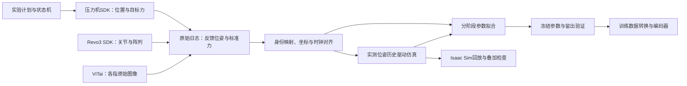

## 2026-10-12：五路指尖相机与手指对应关系（本机实测确认）

本次在连接的 Revo3 右手上，由用户依次轻按拇指、食指、中指、无名指和小指的
视触觉胶面约 2–3 秒后松开，五路相机持续监听。每次仅对应的一路出现明显局部变形，
松开后恢复到空载变化水平；结合原图、差分图和用户指定的手指，确认下表。
下方第7节“SN→手指尚未确认”是 2026-10-03／04 的历史状态，当前以本表为准。

| 物理手指／采集名称 | 相机序列号 SN | 本次视频节点 | 当前完整 URDF 的相机 frame | 指尖胶面 link |
| --- | --- | --- | --- | --- |
| 拇指 `thumb` | `WTUVL2198X260001A` | `/dev/video2` | `right_thumbdip_camera_link` | `right_thumbdip_roll_rubber_link` |
| 食指 `index` | `WTUVL3197X260010B` | `/dev/video8` | `right_index_camera` | `right_indexdip_roll_rubber_link` |
| 中指 `middle` | `WTUVL3194X26000EB` | `/dev/video10` | `right_middip_camera_link` | `right_middip_roll_rubber_link` |
| 无名指 `ring` | `WTUVL3195X26000EE` | `/dev/video6` | `right_ring_camera_link` | `right_ringdip_roll_rubber_link` |
| 小指 `little` | `WTUVL3197X2600106` | `/dev/video4` | `right_pinky_camera_link` | `right_pinkydip_roll_rubber_link` |

相机序列号用于身份识别，`/dev/videoN` 仅记录本次插接结果，重插／重启后可能变化。
本机按以下稳定路径选择每路相机，将 `<SN>` 替换为表中的完整序列号：

```text
/dev/v4l/by-id/usb-YJX-260408-K_ViTai-GFBC_<SN>-video-index0
```

采集可使用已补齐的 [finger_camera_map.json](../config/finger_camera_map.json)，向
`calibration/hardware/collect_real_trimodal.py` 显式传入
`--finger-map calibration/config/finger_camera_map.json`。原有小指映射保持，本次补齐另外四指。
URDF 名称核对自[当前完整场景](../assets/calibration_bench_visuotactile_urdf/urdf/revo3_calibration_scene_xyz.urdf)；
这些 frame／link 是仿真模型中的对应名称，相机外参和像素到胶面坐标的关系仍需标定。

复核证据见[本次会话与逐指结果](../captures/finger_camera_map_20261012_154250/session.json)、
[一致性核查](../captures/finger_camera_map_20261012_154250/validation.json)。按压前／峰值原图、
五路差分图和变化时序位于同目录 `continuous/03_thumb_tap` 至 `continuous/07_little_tap`。
首次逐路打开相机的拇指短测未得到可分离响应，保留原始数据但未用于映射结论；
最终五指均由持续监听中的独立按压确认。这里只完成设备身份映射，未完成几何、深度尺度或力标定。

## 2026-10-11：阅读入口与历史说明

当前本地执行顺序见[本地标定流程](local_workflow.md)，ROS 2 接口见
[硬件说明](../hardware/README.md#标定台-ros-2-接口)。本页保留设计、几何及历史执行记录；
下方“SDK待提供”、旧世界系与旧高度公式应结合各自日期阅读。
当前人工坐标换算看[坐标转换.yaml](../config/坐标转换.yaml)：Tag原点设备Z为−308.2 mm；
历史平台读数−308.5605 mm保持在[坐标登记](../config/coordinate_reference.json)，不覆盖测量记录。
两者与模型推算的平台高度存在差异，完整外参／TCP／接触零点仍需真机验收。

## 2026-10-05 当前默认URDF：支架只保留Tag系

当前支架唯一frame/root为 `tag_center`，移除重复世界、lower_mount、平台/球槽/贴码槽辅助frame。
支架网格与手装配位姿保持；平台几何高度为Tag系Z=0.5mm。手内和压头运动链frame保留。
本页以下坐标系树及v4验证是历史记录，当前v5入口/验证见[包说明](../assets/calibration_bench_visuotactile_urdf/README.md)。

# 机械标定台仿真搭建

## 2026-10-04：默认完整URDF改用 M6×16 局部沉孔版

用户现有螺丝最长为 M6×16。默认完整场景仍使用文首指定路径，其支架视觉和碰撞改为
`lower_calibration_v4_m6x16_print.stl`。在原 V4 上仅加深四处 Ø12 mm 沉孔：
承压面从 Z=24 mm 降至 Z=10 mm，额外切深14 mm；Ø6.8 mm通孔保留。
孔中心（mm）为 `(18,235)`、`(93,235)`、`(143,10)`、`(193,10)`。
支架总高45 mm、底面Z=0、手安装位姿、平台Z=36 mm及全部关节坐标不变。
该版本不是整体截短10 mm的旧V5 M6×20版本。

- [当前完整URDF](../assets/calibration_bench_visuotactile_urdf/urdf/revo3_calibration_scene_xyz.urdf)
- [打印STL，毫米](../assets/calibration_bench_visuotactile_urdf/meshes/hand/mount/mount/lower_calibration_v4_m6x16_print.stl)
- [STEP加工模型](../assets/calibration_bench_visuotactile_urdf/modifications/m6x16/lower_calibration_v4_m6x16.step)
- [3MF打印模型](../assets/calibration_bench_visuotactile_urdf/modifications/m6x16/lower_calibration_v4_m6x16_print.3mf)
- [几何验证](../assets/calibration_bench_visuotactile_urdf/modifications/m6x16/validation.json)

按**圆柱头内六角、头部包络Ø10×6 mm、头下长度16 mm**假设：不加垫片突出底面6 mm；
加1 mm垫片则突出5 mm（垫片外径须能进入Ø12沉孔）。用户实物头型尚未确认。
这是名义突出量，不是实测有效啮合量；平台孔口倒角、盲孔可用深度、螺纹及打印误差仍须实物核对。
切削后的承载／紧固扭矩未验证。更短螺丝的突出量为“头下长度−10 mm−垫片厚度”。

仅更新当前指定完整包；原始V4、V4-touch源包、旧V5及历史场景保留。
旧采集器／导出器从V4-touch源包重建时仍产生旧孔位，须在新导出包中显式应用此派生网格。
本次URDF只改网格引用，坐标测量原始值保留，登记哈希同步更新。
下文2026-10-03的验证与“螺钉结构未改”等描述属于修改前历史记录。

## 2026-10-04：默认坐标基准改为Tag中心，方向沿用原世界系

默认文件仍是 `assets/calibration_bench_visuotactile_urdf/urdf/revo3_calibration_scene_xyz.urdf`，
与[calibration实体文件](../assets/calibration_bench_visuotactile_urdf/urdf/revo3_calibration_scene_xyz.urdf)为同一份。
用户更正后采用：全局根 `calibration_world` 与新增 `tag_center` 重合，方向与原世界系一致，
不与手的 `base_link` 对齐。此次只平移原点，不旋转任何世界轴。

名义Tag中心使用现有 `apriltag_pocket_floor` 位置：支架系 `(0.170, 0.200, 0.0355)` m。
该点为贴码槽底中心；码纸厚度、实际贴码偏心未知，尚非实测码面中心。
`lower_mount`在新世界中的位置为 `(-0.170, -0.200, -0.0355)` m、旋转为0。
任意旧世界点转换为新世界点：`p_new = p_old - (0.170, 0.200, 0.0355)` m。

`world_to_press_stage`的位置变为 `(-0.066785405218073, 0.010899079364512, 0.0125797829510025)` m，
旋转保持 `(0, 0, -pi/2)`。手/支架/压头的相对关系及24个活动关节、初态和轨迹不变。
工具三个link仍共用尖端frame；零关节值是导出初态，不能当成真机接触位置。

用户确认的 **-308.5605 mm** 仍是右侧平台平面基面的机械台显示Z，避开圆槽和贴码槽；
不是手指触觉面零点。该平台支架局部Z仍为0.036 m，**新世界Z为0.0005 m**。
在真机Z与世界+Z同向、读数对应工作尖端触平台的条件下：

```text
z_tip_world_m = 0.0005 + (z_display_mm + 308.5605) * 0.001
q_press_z_m   = z_tip_world_m - 0.0125797829510025
```

对应平台的 `q_press_z=-0.0120797829510025 m` 保持不变；该参考不能直接下发运动。
反向轴须对增量取反，非尖端读数须先处理TCP；单个平台高度不足以确定XY和完整外参。
[coordinate_reference.json](../config/coordinate_reference.json)已更新哈希、frame、条件公式，并保留旧公式的历史标记；
控制器外参仍为空，未启用自动换算。矩阵、修改前备份和CPU复核见
[当前包说明](../assets/calibration_bench_visuotactile_urdf/README.md)。

> 2026-10-04目录整理：本说明现位于 `calibration/`；分类入口和旧路径映射见
> [标定与采集总目录](../README.md)。仿真源码位于 `calibration/simulation/`，真机入口位于
> `calibration/hardware/`；旧路径为兼容链接。下文命令仍从仓库根目录执行。

## 2026-10-04：开始标定的执行框架

**本轮交付是标定方案与数据契约；尚未执行受控加载、参数拟合或设备参数写入。**
本会话用户确认 XYZ 实际位置可读、独立测力可用；机械台 SDK、额外姿态轴定义、测力轴数／量程／
证书及时间戳仍待登记。按“食指 DIP＋球压头先闭环，再扩展五指和其他压头”的顺序开展。
标定产出应同时包含机械几何、真实传感器响应、仿真参数和独立验证，不能以 SDK 通路正常代替。

| 要做的事 | 阅读入口 |
| --- | --- |
| 看已有能力与整体架构 | [第8节](#8-标定目标与系统分工) |
| 装台、找XY、接触Z零点、测力与时钟对齐 | [第9节](#9-真机标定顺序) |
| 把手SDK、压力机和相机接起来 | [第10节](#10-联合采集与压力机状态机) |
| 确定第一批采哪些实验 | [第11节](#11-采集矩阵与实施顺序) |
| 真机轨迹如何对应仿真、如何拟合 | [第12节](#12-仿真对应与参数辨识) |
| 数据如何保存、转成训练输入 | [第13节](#13-数据保存转换与使用) |
| 判断是否标定完成、接下来实现什么 | [第14节](#14-验收与下一步实现清单) |

第1–6节主要保留 V4 原始资产及几何测量，第7节保留 SDK 实测历史。
**当前默认仿真仍为 V4 视触觉手；V5 M6×20 支架已另行生成，未自动接入标定采集器。**
如果实物用 V5，应先执行9.1节的版本核对；当前完整场景的工具 link 已统一到尖端原点，
不能直接套用第5节原始法兰 frame，转换见9.2节。

## 2026-10-03：当前资产切换为任务视触觉手

当前入口为[视触觉手＋V4支架＋球压头XYZ](../assets/calibration_bench_visuotactile_urdf/README.md)，
[URDF](../assets/calibration_bench_visuotactile_urdf/urdf/revo3_calibration_scene_xyz.urdf)、
[Isaac截图](../outputs/simulation/visuotactile_v1/isaac_scene.png)、
[场景](../outputs/simulation/visuotactile_v1/scene.usda)。默认标定配置已更新。
使用 `assets/revo21_right_touch` 原手，保留21关节、5相机frame、橡胶面、压力描述及碰撞；
按任务既有rubber→DIP变换对齐，压头位置与轨迹重新生成。原支架、原资产与旧数据保留。
8/8短回合／99项数据检查、URDF／FK与Isaac回放通过；拇指零位与支架抽样穿入约2.383mm，
机械配合仍待复核，未改变安装固定结构或关闭碰撞。下文旧Revo3手路径及数据为历史版本。

## 2026-10-03：可运行的标定仿真入口

已新增 [标定仿真系统](../simulation/README.md)，入口为
`calibration/simulation/run.py`。使用下文原始 V4 手／支架与三种压头，默认球压头；
按用户要求，场景现只显示压头／法兰和手／V4支架装配；已移除虚拟龙门架、导轨、台面及滑块。
XYZ压头轨迹保留，暂不展示尚未确认的机械台本体。
仿真采集为受控运动的几何／触觉模型，场景在 Isaac Sim 回放，不修改支架和螺钉结构。
真机 SDK 已另行完成只读连接与短采样，见[第7节](#7-revo3-sdk与真机只读采集2026-10-03)；尚未与仿真联动或对齐。

当前任务反查确认，已有 encoder 三模态是 **RGB＋Depth＋Marker**，压力单独保留。
HydroShear 是核心参考与 marker 模型来源，仓库公式稿不是完整目标论文；
本系统同时服务曲面深度、marker、压力及后续三模态研究，不把所有任务认定为单篇论文复现。

- [采集字段、协议、论文依据与注意事项](../simulation/README.md)
- [当前精简版 Isaac 场景截图](../outputs/simulation/head_fixture_only/isaac_scene.png)
- [当前可回放场景](../outputs/simulation/head_fixture_only/scene.usda)
- [含压头XYZ运动的URDF](../assets/calibration_bench_urdf/urdf/revo3_calibration_scene_xyz.urdf)；
  [坐标系调整与轨迹说明](../assets/calibration_bench_urdf/README.md)
- [数据验证报告](../outputs/simulation/validated_v1/verification.json)

已完成球压头8/8短回合、1,574帧、99项一致性检查；三角／锥头各1/1短回合、各115帧。
原生场景54个网格拓扑可读，动画位姿与数据最大元素误差3.71e-10；这是导入／回放检查，
不是动力学、真实触觉精度或全行程碰撞验收。压力和 RGB 仍为未标定模型，真机对齐后置。
输出在 Git 忽略的本地 `outputs/` 中，跨机器需单独携带。下文保留原始资产测量和未处理的机械需求。

## 1. 当前范围与状态

本文记录机械标定场景中已经拿到的 **Revo3 右手＋标定下支架 V4**，以及三种压头和连接法兰的
资产、组装入口与坐标关系。本节至第6节中的原始压头 URDF 是独立工具装配；文首完整包另含虚拟XYZ链。
当前没有经实物标定的机械台本体／运动轴资产，虚拟链不能代替实际行程、安装位姿和传动几何。

当前工作区根目录为：

```text
/home/liuxinyu/workspace/mulyi-model-tac
```

下文未特别说明的路径均相对于该目录。当前可用的支架包为：

```text
calibration/assets/revo3_breadboard_mount/generated_calibration_v4/
```

注意：

- 这是原始 V4 保留包；V1/V2/V3 和 V4 原始生成脚本已经不在当前仓库中。后续新增 V4 视触觉手组合包及 V5 M6×20 派生包，版本选择见9.1节。
- 该目录目前在本地工作区中存在，但 `git status` 显示它尚未被 Git 跟踪；换分支、重新克隆或换机器前需要单独确认资产是否已带上。
- 原资产交付时只有 URDF；本轮新增的受控运动场景和采集入口见本文顶部，完整动力学台架仍待验证。
- 历史文档中提到过 `calibration_bench_sim_package/`，但该目录当前不存在，不能把历史路径当成当前可用资产。

## 2. 当前资产路径

### 2.1 手和支架的完整装配入口

本节是旧手＋V4组合 URDF；当前视触觉仿真优先使用文首的新入口，复核旧资产时使用：

```text
calibration/assets/revo3_breadboard_mount/generated_calibration_v4/urdf/
revo3_right_calibration_lower_mount_v4.urdf
```

完整单行路径：

```text
calibration/assets/revo3_breadboard_mount/generated_calibration_v4/urdf/revo3_right_calibration_lower_mount_v4.urdf
```

该 URDF 已经包含：

- Revo3 右手运动链；
- 标定下支架 `lower_mount`；
- 支架到右手的固定装配关系；
- 球槽底点、标定平面和 AprilTag 槽底三个辅助 frame。

装配拓扑为 61 个 link、60 个 joint，其中 21 个为可动关节。不要再在场景中重复加载一份独立支架，
否则会出现重叠几何。

### 2.2 支架独立入口

只加载支架、不加载手时使用：

```text
calibration/assets/revo3_breadboard_mount/generated_calibration_v4/urdf/lower_calibration_v4.urdf
```

支架的几何文件为：

| 用途 | 当前路径 |
| --- | --- |
| URDF 中的视觉和碰撞网格 | `calibration/assets/revo3_breadboard_mount/generated_calibration_v4/meshes/mount/lower_calibration_v4_print.stl` |
| 3D 打印文件 | `calibration/assets/revo3_breadboard_mount/generated_calibration_v4/meshes/mount/lower_calibration_v4_print.3mf` |
| STEP CAD | `calibration/assets/revo3_breadboard_mount/generated_calibration_v4/cad/lower_calibration_v4.step` |
| BREP CAD | `calibration/assets/revo3_breadboard_mount/generated_calibration_v4/cad/lower_calibration_v4.brep` |

支架 STL 的源单位是毫米，URDF 中通过 `scale="0.001 0.001 0.001"` 转成米。

### 2.3 Revo3 右手资产

当前 V4 包里没有单独的右手 URDF；右手 URDF 内容已经嵌入完整装配入口中。对应网格目录为：

| 用途 | 当前路径 |
| --- | --- |
| 右手视觉网格 | `calibration/assets/revo3_breadboard_mount/generated_calibration_v4/meshes/hands/visual/right/` |
| 右手碰撞网格 | `calibration/assets/revo3_breadboard_mount/generated_calibration_v4/meshes/hands/collision/right/` |

手部 mesh 在组合 URDF 中没有额外的 `scale`，导入器按 URDF 默认单位米解释。不要把历史记录中的外部
`brainco-description` 路径当成当前运行依赖；当前组合包引用的是上述包内相对路径。

### 2.4 预览、设计参数与验证记录

| 内容 | 当前路径 |
| --- | --- |
| 手＋支架装配预览 | `calibration/assets/revo3_breadboard_mount/generated_calibration_v4/preview.png` |
| 支架预览 | `calibration/assets/revo3_breadboard_mount/generated_calibration_v4/fixture_preview/preview.png` |
| 支架设计参数 | `calibration/assets/revo3_breadboard_mount/generated_calibration_v4/design.json` |
| 装配、URDF 和 mesh 验证记录 | `calibration/assets/revo3_breadboard_mount/generated_calibration_v4/validation.json` |
| CAD 验证记录 | `calibration/assets/revo3_breadboard_mount/generated_calibration_v4/cad_validation.json` |

URDF 使用 `../meshes/...` 相对引用。移动资产时应整体保留
`generated_calibration_v4/urdf/` 与 `generated_calibration_v4/meshes/` 的相对目录结构。

### 2.5 三种压头与连接法兰的装配入口

压头和法兰源资产位于：

```text
calibration/assets/head/
```

仿真中按压头形状选择以下一份 URDF，不要再额外加载同一法兰或同一压头 STL：

| 压头 | 完整装配 URDF |
| --- | --- |
| 三角压头＋连接法兰 | `calibration/assets/head/triangle_press_head_with_flange.urdf` |
| 球压头＋连接法兰 | `calibration/assets/head/spherical_press_head_with_flange.urdf` |
| 锥压头＋连接法兰 | `calibration/assets/head/conical_press_head_with_flange.urdf` |

每份 URDF 都包含 `connection_flange`、`press_head` 和 `press_head_tip` 三个 link，以及两个 fixed
joint。`connection_flange` 是根 link；`press_head_tip` 是无几何的工作面参考 frame。视觉和碰撞均
直接引用原始 STL，STL 源单位为毫米，并通过 `scale="0.001 0.001 0.001"` 转为米。三份 URDF
与 4 份 STL 应保持在同一目录；只复制 URDF 会造成相对 mesh 引用缺失。

## 3. 支架局部坐标约定（原始装配包）

本节原始支架装配包使用支架自身坐标系，局部根 link 为：

```text
lower_mount
```

当前完整XYZ URDF以Tag中心的 `calibration_world` 为全局根，`lower_mount` 固定在
`(-0.170, -0.200, -0.0355)` m且轴向不变。标定台到全局根的实测外参另行登记；
下表继续使用支架局部坐标，不改变手和支架的内部装配关系。

URDF 中的长度单位为米、角度单位为弧度。以下变换均相对于父 link：

| joint / frame | 父 link → 子 link | `xyz`（m） | `rpy`（rad） | 含义 |
| --- | --- | --- | --- | --- |
| `lower_mount_to_right_hand` | `lower_mount` → `right_hand_base_link` | `(0.060, -0.0002, 0.040)` | `(-π/2, -π/2, 0)` | 右手在支架上的固定装配位姿 |
| `calibration_plane_fixed` | `lower_mount` → `calibration_plane` | `(0.170, 0.1625, 0.036)` | `(0, 0, 0)` | 支架标定平台参考 frame |
| `calibration_sphere_bottom_fixed` | `lower_mount` → `calibration_sphere_bottom` | `(0.170, 0.125, 0.033)` | `(0, 0, 0)` | 球槽局部最低点 |
| `apriltag_pocket_floor_fixed` | `lower_mount` → `apriltag_pocket_floor` | `(0.170, 0.200, 0.0355)` | `(0, 0, 0)` | AprilTag 槽底，不是贴纸表面 |

其中 `calibration_sphere_bottom` 只是球槽局部基准，不是整个支架的最低点；
`apriltag_pocket_floor` 也不包含未知的贴纸厚度。

## 4. 支架现有几何尺寸

本节只记录支架和支架上的标定结构，**不是压头尺寸**。

| 项目 | 当前值 |
| --- | --- |
| 支架 mesh 边界 | X `[0, 220]` mm，Y `[-3, 249]` mm，Z `[0, 45]` mm |
| 支架总体边界尺寸 | 220 × 252 × 45 mm |
| 标定平台高度 | Z = 36 mm |
| 球面槽 | 口径 40 mm，深 3 mm，球半径约 68.1667 mm |
| 球面槽底点 | `(170, 125, 33)` mm，位于 `lower_mount` 坐标系 |
| AprilTag 方槽 | 55 × 55 mm，深 0.5 mm |
| AprilTag 槽底中心 | `(170, 200, 35.5)` mm，位于 `lower_mount` 坐标系 |

AprilTag 的 family、ID、实际打印外形和贴纸表面高度目前没有确定。

## 5. 标定台与压头资产

### 5.1 源文件和 mesh 测量结果

`calibration/assets/head/` 中每个零件同时提供 SolidWorks `SLDPRT` 和二进制 STL。以下尺寸由 STL 几何测得，
用于仿真装配和量纲核查，不代替制造图纸、公差或实物测量：

| 零件 | CAD / mesh | STL 总体边界尺寸（mm） | mesh 得到的工作端特征 |
| --- | --- | --- | --- |
| 连接法兰 | `连接法兰.SLDPRT` / `连接法兰.STL` | 63.000 × 62.943 × 37.700 | 下端为压头安装孔，法兰自身不作为接触工作面 |
| 三角压头 | `三角.SLDPRT` / `三角.STL` | 5.991 × 12.598 × 6.000 | 端面为边长约 2.2 mm 的三角形，端面面积约 2.096 mm² |
| 球压头 | `球压头.SLDPRT` / `球压头.STL` | 7.079 × 13.418 × 7.059 | 球端外半径约 3.54 mm |
| 锥压头 | `锥.SLDPRT` / `锥.STL` | 9.070 × 14.567 × 9.064 | 锥尖保留约 0.30 mm 直径的平端，不是数学尖点 |

三种压头具有相同的名义直径 6 mm、长度 8 mm 尾柄。法兰下端 mesh 中的对应孔名义直径约
6.4 mm、深 8 mm，因此装配后的径向间隙约 0.2 mm、直径间隙约 0.4 mm。压头与法兰的横向销孔
中心均位于 4 mm 插入深度处；URDF 中已把压头绕装配轴旋转，使两侧销孔同轴。上述接口尺寸同样
来自 mesh，尚未由图纸或实物公差确认。

### 5.2 URDF 装配坐标

三份 URDF 使用相同坐标约定：根 frame 位于法兰中心轴和法兰盘安装面交点，即
`连接法兰.STL` 原始坐标 `(31.5, 31.5, 30.0)` mm。`+Z` 从压头指向机械本体，压入方向为 `-Z`。
原始压头 STL 的轴向是 `+Y`；URDF 的 mesh 变换使用
`rpy=(π/2, 0, π/2)`，把尾柄轴向转到 `+Z`，同时把压头销孔转到法兰销孔方向。

| URDF | `connection_flange` → `press_head`（m） | `press_head` → `press_head_tip`（m） | 根 frame 中 tip 的 Z（m） |
| --- | --- | --- | --- |
| `triangle_press_head_with_flange.urdf` | `(0, 0, -0.030)` | `(0, 0, -0.004598076912)` | `-0.034598076912` |
| `spherical_press_head_with_flange.urdf` | `(0, 0, -0.030)` | `(0, 0, -0.005417815208)` | `-0.035417815208` |
| `conical_press_head_with_flange.urdf` | `(0, 0, -0.030)` | `(0, 0, -0.006567255020)` | `-0.036567255020` |

`press_head` frame 位于法兰安装孔入口和压头尾柄肩部中心；尾柄沿 `+Z` 完整插入 8 mm，工作端沿
`-Z` 伸出。`press_head_tip` 位于三角端面中心、球面轴向最低点或锥形平端中心，且保持与根 frame
相同的轴方向。法兰盘 `Z=30 mm` 被选为仿真安装基准是基于当前 mesh 结构的坐标约定，尚未确认它
是否等于机械图纸或设备控制软件中的法兰零位。

### 5.3 动力学和场景级待确认项

当前工作区仍未提供机械标定台本体或运动轴资产。场景搭建时还需要明确至少两个场景级变换：

```text
world / calibration_bench   -> lower_mount
press_axis / press_carriage -> connection_flange
```

三份 URDF 没有填写质量、质心和惯量，因为零件材料和实物质量尚未提供；导入动态场景时需要按
实物补齐，或明确使用导入器的密度/惯量生成设置。碰撞几何目前与闭合原始 STL 相同，未做凸分解；
若压头作为动态刚体使用，需要在 Isaac Sim 导入后核对实际碰撞近似和接触面精度。最终接触行程
应由 `press_head_tip` 相对于目标触觉面的几何关系计算，不能直接把 `calibration_sphere_bottom`、
支架最低点或法兰安装面当作压头接触零位。

## 6. 当前验证边界

2026-10-03 本次复核支架两份 URDF 均通过 XML 解析；两份 URDF 共 143 个 mesh 引用，当前缺失数
为 0。三种压头和法兰的 4 份 STL 均为闭合、法向一致的单实体网格；三份新增装配 URDF 均通过 XML
和拓扑解析，mesh 引用无缺失。装配几何核查确认尾柄插入 8 mm、销孔中心对齐，并确认三种
`press_head_tip` 与对应 mesh 工作端重合。已有记录还包含支架 CAD/STL 的离线几何检查。
ROS Humble `check_urdf` 本次因本机缺少 `liburdfdom_model.so.3.0` 未执行。

源 URDF 的动力学导入、质量与惯量标定、全行程碰撞检查、压头接触参数、实物装配或真机标定
尚未验收。本轮新增系统只完成从这些资产生成的 USD 原生查看／回放与采集模型一致性检查，
不能将此升级为动力学或真实标定验收。

## 7. Revo3 SDK与真机只读采集（2026-10-03）

**2026-10-04最新复测见7.6节：五路相机已恢复，新采集40帧RGB，SDK成功生成35组三模态数据。
用户未确认空载，深度／Marker仅为相对当前参考帧的诊断输出，未完成物理标定。**
7.5节保留此前相机未枚举的失败记录；7.2节的5路图像是10月3日历史结果。

### 7.1 SDK副本和运行入口

已将 `/home/liuxinyu/workspace/brainco-revo3-sdk` 复制到
[`calibration/brainco-revo3-sdk/`](../vendor/brainco-revo3-sdk/README.md)。
保留原目录；不复制 `.git`、虚拟环境、缓存、日志和编辑器配置。
原环境中的 **bc-revo3-sdk 2.1.0**、**pyvitaisdk 1.0.17** 及其随包模型、原生库、接口存根和许可证
另存于副本的 `runtime/python/`，因此复制的不只是示例代码。
共676个文件、276,582,053字节，来源版本 `52e3fcb35bcbe91e17ab66bd8a0cbccc19d8e69f`；
逐文件SHA256见[复制清单](../provenance/sdk_copy_manifest.json)。
源目录 `artifacts/vision_touch_capture/` 是历史图片，不能作为本次连接证据。

新增[只读探测脚本](../hardware/probe_revo3_readonly.py)，从仓库根目录运行：

```bash
/home/liuxinyu/workspace/brainco-revo3-sdk/.venv/bin/python \
  calibration/hardware/probe_revo3_readonly.py \
  --output calibration/captures/my_new_readonly_probe
```

输出目录必须不存在。脚本优先导入复制的 `runtime/python/`，其余依赖使用上述已存在环境：
Python3.11.15、NumPy1.26.4、OpenCV4.11.0.86。本次未安装包或改动系统驱动；
这个源环境仍是运行依赖，SDK副本不是可直接迁移的完整Python环境。
`--help` 不打开设备。默认只读3次State/Touch、枚举ViTai，并依次读取5个视触觉相机，各预热5帧、保存8帧。
手部／枚举／每路相机分别有40／25／20秒子进程超时；异常和失败日志保留，不覆盖旧记录。
相机枚举只匹配 `ViTai-GFBC` 的 `video-index0`，不采集笔记本摄像头或metadata节点。
流程没有手部运动、使能修改、清零、归零或固件写入；仅相机打开流并请求视频格式。

### 7.2 本次实际读取结果

最终短测时间：2026-10-03 16:05:42–16:05:47（北京时间）。
证据在 [`calibration/captures/revo3_readonly_20261003_final/`](../captures/revo3_readonly_20261003_final/report.json)，
附[5路图像预览](../captures/revo3_readonly_20261003_final/cameras_montage.png)和
[独立数据核查](../captures/revo3_readonly_20261003_final/validation.json)。
`report.json` 的 `passed` 仅表示读取接口及图像数量检查通过；不表示全部模块启用、标定准确或健康验收。

| 项目 | 实测结果 |
| --- | --- |
| 设备 | UltraVisionTouch，右手；SN `BCUVR1205J2600002`，硬件 `0.0.1`，控制器固件 `9.9.9.ML` |
| 主链路 | Modbus RTU，`/dev/ttyUSB0`，5,000,000 bps，从站127（`0x7F`） |
| 稳定串口路径 | `/dev/serial/by-id/usb-BrainCo_USB__-__RS485_Converter-if00-port0` |
| 关节反馈 | 3次完整读取，21个位置／速度／电流／运行状态；逻辑关节布局随报告保存 |
| 触觉布局 | 指腹5模块＋掌部1模块；声明总点数301；不是仿真旧285-taxel布局 |
| 实际触觉数据 | 每次244点有效；拇指指腹57点被禁用，保留 `Disabled` 和 `points=null` |
| 模式 | `PointArray`；各阵列 `TouchValueMode.Force`，SDK输出单位mN；使能掩码 `0x0551` |
| 指尖相机 | 5/5路各8帧，共40帧；每帧640×480×3、uint8；PNG可读，NPZ存RGB |
| 健康读取 | error_code=0，faulted_motor_count=0；但 `SafetyState.Unknown`，电压回报约240.84 V，需核实协议／固件量纲，不能据此确认设备健康 |

主链路阵列顺序以 `module_id` 为准，不能把数组下标当物理模块ID：

| module_id | 部位 | layout声明点数 | 本次有效点数／状态 |
| --- | --- | ---: | --- |
| 2 | 拇指指腹 | 57 | 0，Disabled |
| 4 | 食指指腹 | 52 | 52，Valid |
| 6 | 中指指腹 | 52 | 52，Valid |
| 8 | 无名指指腹 | 52 | 52，Valid |
| 10 | 小指指腹 | 52 | 52，Valid |
| 0 | 掌部 | 36 | 36，Valid |

指尖图像是独立通道；相机SN与物理手指的对应关系**尚未确认**，不从SN前缀或video编号猜测。
以下设备号只适用于本次插接，应使用 `/dev/v4l/by-id/*<SN>-video-index0` 定位：

| 相机SN | 本次节点 | 接收结果 |
| --- | --- | --- |
| WTUVL2198X260001A | `/dev/video2` | 8/8帧 |
| WTUVL3194X26000EB | `/dev/video10` | 8/8帧 |
| WTUVL3195X26000EE | `/dev/video6` | 8/8帧 |
| WTUVL3197X2600106 | `/dev/video4` | 8/8帧 |
| WTUVL3197X260010B | `/dev/video8` | 8/8帧 |

请求MJPG、640×480、30 fps，驱动实际回报120 fps；8帧短窗口接收约58–62 fps。
这是逐路短测，未验证5路同时采集带宽或持续帧率，也没有硬件曝光时间戳和丢帧计数。

### 7.3 已确认接口与尚待标定接口

主链路依据副本的[Revo3 API](../vendor/brainco-revo3-sdk/docs/api/REVO3_API.zh-CN.md)、
[Touch协议](../vendor/brainco-revo3-sdk/docs/device/REVO3_TOUCH_API.md)及
[Python接口存根](../vendor/brainco-revo3-sdk/runtime/python/bc_revo3_sdk/main_mod.pyi)：

| 接口 | 输出／用途 | 本次验证 |
| --- | --- | --- |
| `sdk.Manager().discover(...)`、`manager.connect(detected)` | 指定端口、Modbus、5M、从站127进行发现与连接 | 已执行 |
| `hand.device_info`、`hand.firmware_info`、`hand.joint_layout` | SN、左右手、型号、固件、逻辑关节布局 | 已读取；子模块SN／固件列表为空，不能补造 |
| `await hand.state.snapshot()` | `positions_deg/rad`、`velocities_rpm/rad_s`、`currents_ma/a`、`operating_states`、timestamp | 21关节×3次 |
| `hand.touch.layout`、`await hand.touch.enabled_mask()` | 模块ID、部位、布局ID、点数、信号及使能状态 | 已读取 |
| `await hand.touch.read_mode()`、`await hand.touch.value_mode(module_id)` | 判定points是ADC、mN，还是兼容汇总数据 | 已读取，PointArray／Force |
| `await hand.touch.snapshot()` | `sequence/timestamp/modules`；每模块 `sample_state/points` 等 | 已读取3次，保留Disabled模块 |
| `await hand.touch.snapshot(module_indices=[4])`、`await hand.touch.module_snapshot(4)` | 按**物理模块ID**选择食指指腹，降低读取量 | SDK接口存在；本次未另测选择读取 |
| `await hand.health.snapshot()` | 电流、电压、温度、故障和安全状态 | 已读取；异常解释待确认 |
| `await hand.close()`、`await manager.close()` | 释放串口 | 每次正常退出执行；外部超时会终止子进程并关闭其FD |

`hand.touch` **不提供指尖视触觉图像、深度或marker**。本次相机发现验证了
`pyvitaisdk.VTSDeviceFinder().get_devices()`（`name/SN/index`），原始图像通过
`cv2.VideoCapture(stable_by_id, cv2.CAP_V4L2).read()` 获取；OpenCV输出BGR，脚本转RGB后写入NPZ。

ViTai高层接口见副本
[VTSensor存根](../vendor/brainco-revo3-sdk/runtime/python/pyvitaisdk/vts/core/vt_sensor.pyi)、
[GFSensorBase存根](../vendor/brainco-revo3-sdk/runtime/python/pyvitaisdk/vts/core/base/gf_sensor_base.pyi)与
[VTSDataType定义](../vendor/brainco-revo3-sdk/runtime/python/pyvitaisdk/vts/core/base/profile.pyi)。
以下是2026-10-03核查的接口定义，**当时没有生成或验收这些推理结果**；10月4日结果与推荐接口见7.5–7.6节：

| 接口 | 后续用途及前提 |
| --- | --- |
| `VTSensor(config=..., model_path=..., force_model_path=...)` | 根据已确认传感器型号、对应模型创建运行对象；不能以通用GFBC名称代替具体型号确认 |
| `get_raw_frame()`、`get_warped_frame()`、`set_warp_params(...)` | 原始／透视变换图像；需要记录裁剪、变换参数与输出尺寸 |
| `set_background(...)`、`init_marker(...)`、`tracking(...)` | 确认无接触后建立图像和marker基准，再跟踪；本次没有擅自把当前姿态认定为空载 |
| `get_origin_markers()`、`get_markers()`、`get_markers_displacement()` | marker参考／当前位置／位移；像素顺序、ID稳定性、丢点掩码和物理尺度待核对 |
| `recon3d(frame)`、`get_depth_map()` | 模型估计深度；单位、零面和几何精度需用标定压头验证 |
| `collect_sensor_data(*data_types)` | `RAW_IMG/DEPTH_MAP/MARKER_*_VECTOR/FORCE6D_VECTOR`等；可请求不等于本机已验证 |
| `release()` | 释放ViTai高层对象资源 |

副本含GFBCI/GFBCT深度和力模型，但没有验证具体SN对应哪一模型。
模型深度和力是估计结果，不能充当压头位移或参考测力计真值；mN点力也不能直接当成Pa压力，
转换还需要taxel面积及曲面法向标定。

### 7.4 论文标定采集字段和联调约定

| 数据 | 最低保存内容 | 当前阶段 |
| --- | --- | --- |
| 指尖图像 | SN、原始RGB、分辨率、颜色顺序、相机格式、主机接收时间、采集序号、读取失败 | 已短采样；相机内参／曝光设置／曝光时间戳未标定 |
| 手部状态 | 手SN、关节布局、21关节位置／速度／电流、SDK与主机时间 | 已短采样；到URDF关节的符号／零位映射待核对 |
| 指腹／掌部阵列 | module_id、layout_id、value/read mode、sample_state、points、使能掩码 | 已短采样；禁用／故障不得补零后当有效标签 |
| marker | reference/current、位移、ID和有效掩码、坐标单位、基准图像、算法版本 | 10月4日已生成诊断光流；空载、物理尺度和跟踪质量仍待标定，见7.6节 |
| 深度 | 原始估计、零面、有效掩码、单位、模型与标定哈希 | 10月4日已生成SDK诊断深度；单位、零面和精度仍待标定，见7.6节 |
| 机械台／参考力 | XYZ命令与反馈、压头tip位姿、接触零点、参考力／力矩、阶段、方向、加载速率 | 台架SDK尚未提供／连接；仿真轨迹不是真机反馈 |
| 样本元数据 | episode/frame ID、工具几何、实际手指映射、材料状态、空载／加载／保持／卸载、重复次数、失败原因 | 后续与仿真schema建立显式转换 |

本次输出：`hand.json`保留完整SDK快照；各SN目录中的`frames.npz`含
`rgb`、`host_read_start_monotonic_ns`、`host_read_end_monotonic_ns`、`host_read_end_unix_ns`，
另有`last_frame.png`、`camera.json`和每个子进程日志。`vitai_finder.json`记录相机发现结果。
每路相机先后采样，序号仅是应用保存索引，不能用相同数组下标拼成同步训练样本。

同步时保留SDK的 `Timestamp.clock/sec/nsec`：本机返回 `ProcessMonotonic`，其起点不能直接与
Python `time.monotonic_ns()` 或其他SDK时钟相减。使用每次读取前后主机时间估计时间偏差与区间，
记录配对误差；后续联合采集须另做并发、延迟和丢帧测量。
先人工确认相机SN→手指和阵列ID→曲面映射，再做相机／marker／深度标定、压头XYZ与接触Z零点对齐。
机械台到法兰、支架到世界的变换单独保存，不因这次SDK读取去修改当前URDF。
仿真训练所用RGB＋Depth＋Marker和额外压力通道仍按各自单位保存，不能直接把301点布局或244点有效子集塞进旧285-taxel接口。

### 7.5 本机连接配置与三模态复测（2026-10-04）

这里“三模态”按当前仿真定义指 **RGB图像、Depth深度、Marker位移**。
关节反馈及指腹／掌部点力是另行保存的通道，不能把它们计作深度或Marker。

#### 本机运行入口

新增 [`calibration/probe_local.sh`](../hardware/probe_local.sh)，固定本机已有SDK解释器，
调用7.1节的有限只读采集脚本；Python入口优先使用仓库内SDK副本。
不需要激活Conda、不需要重装SDK或更改系统驱动。从仓库根目录运行：

```bash
# 离线帮助，不打开设备
bash calibration/hardware/probe_local.sh --help

# 真机只读短采集；输出目录必须不存在
bash calibration/hardware/probe_local.sh \
  --port /dev/serial/by-id/usb-BrainCo_USB__-__RS485_Converter-if00-port0 \
  --slave-id 127 --frames 8 --expected-cameras 5 \
  --output calibration/captures/my_new_connection_check
```

主链路仍为Modbus RTU／5,000,000 bps／从站127。默认Python为
`/home/liuxinyu/workspace/brainco-revo3-sdk/.venv/bin/python`，可用`REVO3_PYTHON`显式覆盖；
依赖仍来自该源环境，因此不是独立可迁移安装。
已验证bc-revo3-sdk 2.1.0、pyvitaisdk 1.0.17、NumPy 1.26.4、OpenCV 4.11.0.86，
及ONNX Runtime 1.20.1的CPU模型加载。GFBCI和GFBCT两份深度模型均能加载，
这不等于已确认设备型号匹配或完成深度推理。
证据：[SDK预检](../captures/revo3_readonly_20261004_connection/sdk_preflight.json)、
[模型路径／SHA256／加载结果](../captures/revo3_readonly_20261004_connection/onnx_model_load.json)。

#### 13:44首次实测结果（后续恢复见7.6节）

本机入口复测时间：2026-10-04 13:44:49–13:44:50（北京时间）。
[完整报告](../captures/revo3_readonly_20261004_local_entry/report.json)、
[独立核查](../captures/revo3_readonly_20261004_local_entry/validation.json)、
[USB枚举](../captures/revo3_readonly_20261004_local_entry/usb_inventory.txt)。

| 通道 | 本次结果 | 边界 |
| --- | --- | --- |
| 手部主链路 | UltraVisionTouch右手，SN `BCUVR1205J2600002`，21关节×3次快照成功 | 位置／速度／电流／运行状态维度与有限值核查通过 |
| 指腹／掌部点力 | 3次快照，每次244个有效点；PointArray／Force | module 2拇指指腹57点仍Disabled；未修改使能或清零 |
| RGB | 0/5路ViTai；SDK `get_devices()` 返回`[]` | 系统仅有Chicony笔记本摄像头的video0/1，未采集它们 |
| Depth | 未取得 | 当前缺少视触觉输入图像；模型可加载不能替代实测 |
| Marker | 未取得 | 当前缺少视触觉图像和已确认空载基准 |

主链路独立数据检查18/18通过；整次探测`passed=false`、退出码2，原因是缺少5路相机。
不是SDK安装失败，也不能将10月3日的旧图像算作本次三模态结果。
健康快照仍有`SafetyState.Unknown`、约240.9 V的电压回报，以及非零motor fault原始码与
`faulted_motor_count=0`并存；保留原值，不据此给出健康验收结论。
本次没有发送运动、归零、使能或固件配置命令。

#### 三模态统一接口

本机pyvitaisdk 1.0.17运行时docstring确认：推荐使用`calibrate()`和
`collect_sensor_data(*data_types, frame=None)`；7.3节列出的`get_raw_frame()`、
`recon3d()`、`get_depth_map()`、`init_marker()`、`tracking()`、
`get_markers_displacement()`仍存在，但已标记弃用。

| 数据 | `VTSDataType` | 含义／保存约定 |
| --- | --- | --- |
| 原始图像 | `RAW_IMG`（2） | 保存原始数组和实际颜色顺序；现有OpenCV入口明确BGR→RGB，高层SDK颜色顺序尚待实机核对 |
| 校正图像 | `WARPED_IMG`（3） | 与推理使用的图像坐标对应，记录warp参数和实际尺寸 |
| 深度 | `DEPTH_MAP`（5） | 模型估计；保存shape、dtype、单位、有限值掩码和模型SHA；单位／零面尚未实测 |
| Marker参考／当前坐标 | `MARKER_ORIGIN_VECTOR`（7）、`MARKER_CURRENT_VECTOR`（8） | 保留原始结构、点序与参考图；不得默认等同仿真marker数量或顺序 |
| Marker位移 | `MARKER_OFFSET_VECTOR`（9） | 保留原始结构及有效性信息；坐标单位和物理尺度待验证 |
| SDK时间 | `TIME_STAMP`（0） | 同时记录主机读取起止时间，未证明与其他通道硬件同步 |

下例是依据本机接口签名整理的**接线模板，尚未在本次在线执行**。先连接相机，
由`get_device_by_sn()`选择本次实际枚举的SN，再核对SDK所选型号及模型。
`calibrate()`需要人工确认无接触的基准状态；不能对未知加载状态直接建立标定零面。

```python
from pyvitaisdk import VTSDeviceFinder, VTSensor, VTSDataType as D

# CAMERA_SN由本次VTSDeviceFinder().get_devices()和实际指尖对应关系确定
device = VTSDeviceFinder().get_device_by_sn(CAMERA_SN)
if device is None:
    raise RuntimeError("目标ViTai相机未连接；不回退到video0或历史图片")
sensor = VTSensor(config=device)  # SDK按SN选择产品类，仍需核对型号／模型
try:
    # 仅在已确认空载后执行；返回的校正基准图也应保存
    baseline = sensor.calibrate()
    data = sensor.collect_sensor_data(
        D.TIME_STAMP, D.RAW_IMG, D.WARPED_IMG, D.DEPTH_MAP,
        D.MARKER_ORIGIN_VECTOR, D.MARKER_CURRENT_VECTOR, D.MARKER_OFFSET_VECTOR,
    )
    raw_image = data[D.RAW_IMG]
    depth = data[D.DEPTH_MAP]
    marker_offset = data[D.MARKER_OFFSET_VECTOR]
finally:
    sensor.release()
```

返回契约为`dict {data_type: data}`；空值、异常、NaN及丢点应显式记录，不补成有效零值。
一次联合调用也不能直接证明与RS485或其他相机同步。现有`probe_local.sh`验证的是
State／Touch／原始相机通路，**并不执行以上深度／Marker标定推理**。

当时下一步为检查相机USB数据链路、供电及集线器连接，直到`/dev/v4l/by-id/`出现ViTai节点且
SDK枚举出目标相机；串口已读通不代表相机USB已连接。随后确认SN→物理手指和空载基准，
再实际验收同次采集的RGB、Depth、Marker及短时连续性。当前根因仅定位到操作系统未枚举相机，
尚不能区分线缆、供电、集线器或设备端问题。

### 7.6 五路三模态通路验证（2026-10-04，相机重新接通后）

用户重新连接后，本次`probe_local.sh`成功读取五路各8帧，共40帧640×480 RGB，
同时再次读取21关节及244有效点。SDK枚举5/5，整次原始采集退出码0。
随后对**这批新采集图像**执行SDK推理：每路第0帧作临时参考，第1–7帧生成RGB／Depth／Marker，
共35组三模态；5路均成功、各数组非空且有限，独立数据一致性检查60/60通过。
推理执行时间为13:55:07–13:55:12（北京时间）。这是逐路采集后批量推理，未验证五路并发实时推理。

**用户明确表示有指尖接触物体或接触状态不确定。** 因此全部记录为
`reference_state=unverified-current`、`physical_calibration_validated=false`。
调用SDK `calibrate(reference_image)`仅建立进程内图像参考，未写硬件标定或执行运动；
成功返回不意味着参考为空载、深度为绝对压入量或接触力标定准确。

| 相机SN | SDK判定产品类 | 每帧Depth | 每帧Marker origin/current/offset |
| --- | --- | --- | --- |
| WTUVL2198X260001A | GFBCT | 180×320，float32 | 各20×20×2，int64 |
| WTUVL3194X26000EB | GFBCI | 240×320，float32 | 各20×20×2，int64 |
| WTUVL3195X26000EE | GFBCI | 240×320，float32 | 各20×20×2，int64 |
| WTUVL3197X2600106 | GFBCI | 240×320，float32 | 各20×20×2，int64 |
| WTUVL3197X260010B | GFBCI | 240×320，float32 | 各20×20×2，int64 |

产品类来自SDK工厂`VTSensor._detect_product(SN)`，不是按video编号猜测手指；
**SN→物理手指的映射仍待人工确认**。模型路径及SHA256逐路保存。
当前`AdaptiveOpticalFlowTrackerAdapter`返回20×20采样网格的光流结果，
不能将400个网格采样点描述成400颗真实印刷marker或仿真marker ID。
每帧均核对`offset == current - origin`。GFBCT本次短窗offset全0，四路GFBCI分量在−1～1之间；
未施加受控载荷，不能将这些微小变化解释为有效接触响应，也没有验收亚像素精度／物理尺度。
深度保留SDK原单位；没有把数值擅自标成毫米。SDK没有在此接口提供逐点跟踪置信掩码，
有限值检查不等于光流跟踪质量验收。

#### 可复现的采集与推理命令

新增 [`calibration/probe_revo3_trimodal.py`](../hardware/probe_revo3_trimodal.py)，
只处理指定采集目录，不打开串口或相机、不控制手部。每路子进程45秒超时，失败日志保留，输出拒绝覆盖。

```bash
# 第一步：新采集；目录名自行选择，必须不存在
bash calibration/hardware/probe_local.sh --output calibration/captures/new_rgb_capture

# 第二步：使用这批图像生成三模态；当前接触状态未确认，明确使用诊断参考
OPENBLAS_NUM_THREADS=1 OMP_NUM_THREADS=1 \
  /home/liuxinyu/workspace/brainco-revo3-sdk/.venv/bin/python \
  calibration/hardware/probe_revo3_trimodal.py \
  --capture calibration/captures/new_rgb_capture \
  --output calibration/captures/new_trimodal_diagnostic \
  --reference-state unverified-current
```

只有确认**源图像采集时**各指尖确实空载，才可填写`--reference-state unloaded-confirmed`；
它只记录人工确认条件，并不自动完成物理尺度、压头零位或力标定。`--help`不打开硬件。

实现沿用SDK工厂的模型、输出尺寸、20×20网格和`marker_offsets=[10,10,10,10]`，
使用具体`GFBCI/GFBCT`类显式设置`VideoStreamFmt(640,480,30,"MJPG")`匹配原始图像。
SDK工厂默认320×240不能直接接受640×480：初次尝试触发`InvalidFrameSizeError`，
失败日志保留在原始采集目录`inference_trial.log`。最终版本不通过随意缩图来绕过尺寸契约。
推理显式关闭lowcost缓存，逐帧调用`collect_sensor_data(..., frame=bgr)`；
SDK返回的`RAW_IMG`逐像素核对与传入BGR一致，同时保存明确RGB通道顺序的源图像。
输入尺寸匹配不代表SDK默认warp已完成实物几何标定，warp参数原样留档。

每路输出`reference.npz`（原始参考RGB及校正BGR）、`trimodal.npz`
（rgb/raw_bgr/warped_bgr/depth/marker_origin/marker_current/marker_offset、源帧索引、
原采集时间戳和推理时间）及`inference.json`（型号、模型SHA、warp、shape、dtype、范围和错误）。
同一输出帧的RGB与推理来自同一张源图像；不同相机按顺序采集，不能将相同帧号当作跨相机同步。

证据：[新原始采集](../captures/revo3_reconnected_20261004/report.json)、
[三模态报告](../captures/revo3_trimodal_20261004_diagnostic/report.json)、
[独立60项核查](../captures/revo3_trimodal_20261004_diagnostic/validation.json)、
[五路三模态预览](../captures/revo3_trimodal_20261004_diagnostic/preview.png)。
图中Depth色标为SDK原单位；Marker展示20×20网格位移幅值，不是物理力图。
下一步是确认空载并重采参考、确认SN→手指、再进行已知位移／参考力加载和同步／持续速率验收。

## 8. 标定目标与系统分工

### 8.1 本项目要标定的四层关系

| 层次 | 要回答的问题 | 交付物 |
| --- | --- | --- |
| 机械几何 | 压头实际在哪、碰到哪根手指、沿哪个方向压入多少 | 手指／设备映射、关节映射、台轴与支架变换、工具TCP、接触零面及不确定度 |
| 真实传感器 | RGB、SDK深度、光流、阵列ADC／点力分别对应什么物理量 | 空载参考、图像到曲面映射、深度尺度、阵列响应／串扰／迟滞、时钟模型 |
| 触觉仿真 | 同一压头位姿历史能否生成与实测相符的响应 | 分指参数包、真实轨迹重放、拟合记录、独立留出误差 |
| 表示与策略 | 标定后数据能否进入现有 RGB＋Depth＋Marker 网络 | 显式数据转换、冻结输入契约、sim/real成对数据、编码器版本及下游独立评测 |

先完成前三层，再决定是否训练或重训编码器。压力／点力是独立通道，不能替代三模态之一。
传感器标定也不等于 Flexiv 臂手外参、关节驱动动力学、螺纹／物体摩擦或完整任务迁移已经完成。

### 8.2 当前实现与待开发边界

| 模块 | 已有依据 | 还缺什么 |
| --- | --- | --- |
| 真机读通 | `calibration/hardware/probe_local.sh`、`probe_revo3_readonly.py`；21关节、244有效点、五路RGB历史短测 | 持续并发记录、机械台及参考力接入、ADC模式采集验收 |
| 图像推理 | `calibration/hardware/probe_revo3_trimodal.py`，同一源图像生成RGB／深度／光流 | 固定空载基准、物理尺度、质量掩码；当前35组仅诊断 |
| 标定模型 | `calibration/simulation/run.py` → `protocol.py`／`model.py` | 实测轨迹导入、真实相机观测映射、参数拟合器、误差报告 |
| 可视化 | `scene.py`生成USD，`preview_isaac.py`回放 | 实测与模型轨迹／接触位置叠加；非实时控制主循环 |
| 台架流程 | [压力机原始流程](标定流程.md)：点位→五轴姿态→接触→目标力→稳定→ADC→写参→复验 | 具体SDK／消息协议、姿态轴与TCP、稳定窗口和异常处理实现 |
| 下游学习 | `scripts/tactile_representation/`的数据缓存、恢复网络、两塔对齐和导出入口 | 本标定schema到训练schema的转换与验收，不能直接混入旧缓存 |

沿用本项目 **Python采集／辨识＋Isaac Sim场景回放＋Isaac Lab下游验证**。
这是复用现有实现的工程选择；本轮没有对 Gazebo 或其他平台做性能比较，也不需要先迁移平台。
实时运动与限力由压力机控制器负责，上位机记录与协调；GPU推理和场景显示不能阻塞控制器。



这是目标架构。图中联合状态机、实测重放、拟合和训练转换尚未实现；现有探测命令不能代替它们。

## 9. 真机标定顺序

### 9.1 固定装配、版本和设备身份

第一次只选择**食指DIP、球压头、固定手姿**，记录装配照片、压头／胶体状态、温度、安装方式和设备SN。
用户已确认位置反馈与独立测力可用；执行前还需填入控制器型号、SDK入口、反馈单位、轴顺序／方向、
测力传感器轴数、量程、分辨率、最近校准信息、实际采样率、停止／卸载接口和通讯超时行为。
原始流程提到五轴，但当前仿真运动链只有XYZ；额外两轴的旋转中心、先后顺序与角度零位尚未知。

**选对支架和手模型：**

| 实物／数据版本 | 仿真对应与处理 |
| --- | --- |
| V4原手 | 第2节旧组合包；只用于对应旧数据，不套用新视触觉手的关节或相机映射 |
| V4视触觉手 | 当前 `config.json` 的 `hand_asset=revo21_touch_v4`；完整XYZ包为 `calibration/assets/calibration_bench_visuotactile_urdf/` |
| V5 M6×20视触觉手 | [V5说明](../assets/revo3_breadboard_mount/generated_calibration_v5_m6x20/README.md)；相对同一台面手／辅助frame名义降低10 mm，须重新测外参和接触零点 |

`geometry.py:hand_asset()`目前只接受旧V4和视触觉V4两个值，没有V5配置入口。
若实物使用V5，应新增独立资产选择及其轨迹／配置后验证；不能只在数据里减10 mm就宣称完成对应，
也不能覆盖原V4资产或复用其接触零点。拇指与支架已有约2.383 mm抽样穿入线索，全行程净空待核实。

固定姿态记录21个关节的**反馈值和名称**，建立 `SDK关节 → URDF关节、符号、零位、单位` 映射，
用小范围已知动作或外部测量逐项核对。未做映射前不能按数组位置复制；手的安装关系与指腹姿态分开保存。
加载时持续记录关节变化：传动回差、关节让位、夹具挠曲都会使台轴位移偏离真实胶体压入量。

逐根手指做可见、轻微且独立的接触识别，保存前后图像与阵列变化，确认 `camera_SN → finger → sensor_link`。
阵列继续以 `module_id/layout_id/point_id` 标识；module 2拇指指腹目前Disabled，不改成有效零数据。
SN编号、video顺序以及GFBCI/GFBCT产品类均不能代替物理手指核对。

### 9.2 统一坐标与TCP，再标定XY

本框架当前以 `W=Tag中心的calibration_world` 为比较世界系，方向沿用原世界轴向。
支架 `lower_mount` 通过URDF固定变换接入W，台架位置通过实测外参记录。历史数据的W可能为lower_mount，须按记录版本转换。
`B`=真机台基座，`M`=末级运动平台，`F`=原始物理法兰安装面，`I`=工作尖端，
`S`=目标传感器曲面参考系，`C`=该指相机，`L`=参考测力计。
约定 `T_A_B` 把B系列向量坐标变到A系；长度m、角度rad、时间s、力N、力矩N·m，四元数顺序显式保存。

```text
T_W_I(t) = T_W_B · T_B_M(q_measured(t)) · T_M_F · T_F_I
T_S_I(t) = inverse(T_W_S(q_hand(t))) · T_W_I(t)
```

三轴时工具朝向可固定；五轴时 `T_B_M` 必须包含实测姿态和真实旋转中心，不能把AB角直接填成世界roll/pitch。
球压头 `I` 是轴向最低点，不是球心；计算接触几何时另用实测球半径及球心相对I的变换。
第5节约3.54 mm半径来自网格，正式几何参考还须实物尺寸／公差；每次换工具重建TCP和零点。

**特别核对两种工具frame：**

- `calibration/assets/head/*_press_head_with_flange.urdf` 和当前采集NPZ的 `T_world_flange`：F在物理安装面。
- 完整XYZ包 `calibration_scene_urdf_v3`：名为 `connection_flange` 的link已移到共同尖端，轴向也已重表达。
  使用该包 `manifest.json` 的 `T_source_flange_shared_tip`：
  `T_W_shared_tip = T_W_source_flange · T_source_flange_shared_tip`。
  反向导入原模型时右乘其逆矩阵，不能只平移、只旋转，或再次补偿一次TCP。
- 原数据世界系与导出XYZ轴不同；以URDF joint轴和完整矩阵为准，不能依据同名X/Y直接复制控制器坐标。

XY定位采用已知定位孔／基准点，保存**名义坐标、实测台坐标和测量方法**。如果提供的是孔中心，
不能把单次碰孔壁的接触点当成孔中心；用对向探测／圆拟合并补偿探针半径，保留重复测量。
建议覆盖工作区取至少4个分散点，其中至少3个非共线点用于拟合，余点独立验证；再通过已测平面法向／
高度检查Z和坐标手性。仅有XY表格不能确定完整3D外参或TCP朝向。
拟合刚体变换后，检查轴比例、正反向重复定位、正交误差和回差；必要的轴误差补偿应单独保存，
不能让任意缩放矩阵掩盖 mm/m 错误。报告独立点的残差、最大值、重复性和覆盖范围。
AprilTag可作复位检查，但未确认内参、码尺寸、贴纸表面高度时不能替代上述测量。

### 9.3 建立真实空载与接触Z零点

1. 在压头离面且各目标触觉面无外物接触时，等图像／力／阵列基线稳定，连续记录空载段。
   保存原RGB、SDK所用参考图、各点零偏／噪声、曝光／warp、关节姿态、参考力tare及温度。
   噪声和稳定窗口由预试验确定；原仿真0.2 s空载不是实物稳定时间要求。
2. 测力计零点应在实际装夹和当前姿态下建立。确认压头、法兰和线缆自重是否计入；
   改变姿态需重力补偿或对应空载基线，动态试验还须评估惯性影响。
3. 在指定XY和固定手姿缓慢接近。以独立参考力超过基线噪声阈值并持续满足窗口作为主要接触事件，
   用图像／阵列辅助核对；记录最后未接触点和首次可靠接触点、速度、阈值及事件延迟。
   每个位置至少重复3次，得到 `z_contact(x,y,q_hand,tool,session)` 与重复性，而非全手共用一个Z值。
4. 阈值触发时通常已经有微小压入。保留该检测零点及其不确定度；若用初始力—位移段外推零载接触，
   明确拟合区间／模型，另存外推零点，不能把检测位置直接称为无偏的几何首接触。
5. 换手姿、压头、胶体、支架或重新装夹后重新检查零点。曲面侧移时用局部零面／几何模型决定Z轨迹；
   当前仿真 `follow_surface_for_slide=true` 只维持模型几何压入，并不实现真机恒力。

固定竖直轴下可先记录 `d_stage = z_contact - z_tip`，向下为正；它是**相对台轴位移**。
沿局部法向的近似位移为 `d_normal = -n_S · (p_tip - p_tip_contact)`，坐标必须同系。
胶体真实压入还受曲率、接触点迁移、关节让位及夹具顺应性影响；只有外参和顺应性误差受控后，
才把实测位姿＋压头几何构成的深度称为几何参考，不能无条件称为稠密形变真值。

### 9.4 参考力、阵列ADC与点力的标定

先明确测力计输出是“作用于工具”还是“作用于传感器”，通过已知压缩方向核对正负。
变换到传感器S系且改变力矩参考点时，使用：

```text
F_S = R_S_L · F_L
tau_S = R_S_L · tau_L + p_S_L × F_S
```

这里 `p_S_L` 是从S原点指向L原点、在S系表达的向量。若读到的是工具反力，需在完成自重／偏置处理后，
对接触wrench整体取反以得到作用于传感器的量。当前仿真 `force_on_sensor_w_n` 朝胶体内侧，
外法向为n时压缩标量取 `F_n = -n · F_on_sensor`。单轴测力计只能验证其测量轴的投影，
不能补造切向力／力矩；六维数据则保留全部分量与坐标原点。

依据压力机流程，真实阵列拟合优先采 **ADC原值＋标准力＋位置＋加载方向**。当前探测处于Force模式，
没有验收ADC采集或写参；ADC模式及切换方式必须先由设备协议核实，不在此虚构SDK调用。
若暂时只能取SDK的mN点力，可做出厂映射的偏差校验，但不能称为重新拟合原始ADC曲线。

先拟合每模块／局部可辨识区域的零偏、增益、非线性、迟滞、重复性、串扰和饱和范围。
用密集位置扫描形成不同接触分布，再判断是否足以辨识逐点参数；一个总力值不能唯一解出几十个点力。
曲面上SDK各点的受力方向／有效面积未确认前，不直接把点力总和等同标准力某一轴。
`mN × 1e-3 = N`只完成量纲换算；`p_i = f_i/A_i`还要求有效面积和法向定义成立。
六维力和已知TCP可约束合力及部分接触位置，但不能单独证明稠密压力分布或任意曲面CoP正确。

### 9.5 统一时钟与误差预算

各原始流保留本机读取起止时刻、设备时间戳及其时钟域、序号和丢帧信息。
有共同触发／硬件时间戳时优先使用并实测延迟；否则在会话前后测共同接触事件，建立
`t_host = a · t_device + b`，记录漂移、残差和适用区间。SDK的ProcessMonotonic不能直接当Python时钟。
读取区间只能约束API耗时，缓存图像可能早于读取开始；不能把读取中点无条件认定为曝光时刻。

以已标定相机曝光／估计采样时刻为锚，插值匹配台轴反馈和标准力；旋转用合法SO(3)插值，
状态／故障／使能等离散字段不插值。拒绝跨大缺口、回合边界、装夹变化或基准重置配对。
每一对记录误差估计与 `pair_valid`，未知曝光延迟不能通过改帧号变成同步。
共同事件相关性用于测延迟，不逐回合任意时间扭曲来消除材料真实迟滞。

时间容限从空间／力误差预算倒推，例如 `位置误差 ≈ 速度 × 时间误差`：
2 mm/s运动的5 ms误差约10 μm，仅为算例，不是已经达到的精度或默认门槛。
另外统计编码器、TCP、外参、接触零点、夹具顺应性及相机映射误差；相关误差不能简单假设独立。
没有可信动态同步时，先使用经稳定窗口验收的静态平台段拟合，动态段保留为待验证数据。

## 10. 联合采集与压力机状态机

### 10.1 SDK分工与接口约定（待实现）

不把压力机SDK塞进Revo3 SDK；由独立上位机协调几个适配器，并统一事件ID和主机时钟。

| 适配器角色 | 需要提供的能力 | 当前情况 |
| --- | --- | --- |
| 压力机 | 提交点位／姿态、位置反馈、接触搜索、目标力及标准力、稳定事件、停止／卸载／限位状态 | SDK待提供；五轴与恒力流程来自原始流程文档，尚未程序验收 |
| Revo3 | 带名称的关节反馈、阵列layout／mode／ADC或Force、健康／使能状态 | 有只读入口，当前Force模式；共享串口需单一连接拥有者 |
| ViTai | 每SN独立原始图像、采样时间、基准ID和格式 | 有逐路短采，尚未多路持续并发验收 |
| 参考力 | 有校准来源的力／力矩及时间戳、饱和／故障位 | 可由压力机SDK同时提供；不重复占用同一设备连接 |
| 记录与派生 | 原始流落盘、时钟转换、SDK推理、质量标记和同步样本构建 | 后三项需联合采集器实现；离线推理可复用现有入口的处理逻辑 |

RGB原始采集优先，SDK推理可在旁路或离线运行；落盘堵塞或队列溢出要记录缺口，
不能为了保持界面帧率静默丢弃失败段。先验收单指持续采集，再验收五路并发实际吞吐。

### 10.2 一次完整试验

```text
PRECHECK → MOVE_CLEAR → POSITION → BASELINE → CONTACT_SEARCH
         → LOAD → STABLE/HOLD → [SHEAR/SLIP_SCAN] → UNLOAD → RELEASE → COMPLETE
任一阶段异常 → ABORT → 控制器规定的停止／可控卸载 → 保存原因与触发前后数据
```

- **PRECHECK**：校准版本与设备匹配、手姿／基准有效、端口可用、标准力未饱和、实物行程及限值已登记。
- **MOVE_CLEAR／POSITION**：先在已核实净空高度移动XY／姿态；不从上一接触点贴面横穿其他手指。
- **BASELINE／CONTACT_SEARCH**：分别保存空载参考和接触事件；接触搜索超时／超行程即结束本回合。
- **LOAD**：选择位置模式或恒力模式，并保存目标值、反馈、控制器状态；不同模式的数据分组。
- **STABLE/HOLD**：压力机“稳定”消息只作为候选事件；上位机复核窗口内力误差、波动、力变化率、
  位姿漂移、连续时长及有效采样数。瞬时达到目标不等于稳定。窗口通过后保留整段数据而非一帧。
- **SHEAR／SLIP_SCAN**：声明恒法向位置或恒法向力，记录实际Z修正。额外姿态轴未建模时不做假想旋转对应。
- **UNLOAD／RELEASE**：保存卸载迟滞和离面恢复；判断残余基线后再进入下一回合。
  原流程“回零”应区分退回已确认安全位与硬件重新homing；碰撞／断连后不能盲目自动回零。

每条运动命令带 `command_id/episode_id`，每条反馈带源序号、时间、接受／完成／故障状态。
重连先查询实际状态，不能自动重发可能已执行的加载命令。限力、限位和看门狗应在设备控制层有效，
不是依靠相机、GPU推理或Python循环及时响应。
独立登记最大法向／切向载荷、轴行程、速度、加载速率、通讯超时、稳态超时和允许压入量；
这些值依据实物额定值与预试验填写，不能照抄仿真的20 N／0.8 mm限制。

恒力稳定条件建议写成可复核规则：在同一连续窗口内，`|mean(F_n)-F_target| <= eps_force`、
`std(F_n) <= eps_noise`、`|slope(F_n)| <= eps_slope`，同时满足位姿漂移容限、最少有效采样数和最长等待时间。
窗口长度与各容限写入plan，不在拟合后改门槛。保持／松弛实验另行保留未稳定阶段，不能把它作为坏数据删掉。

### 10.3 芯片写参是单独的发布阶段

原流程第9–12步细化为：**主机离线拟合 → 未参与拟合的验证点验收 → 冻结候选包 → 写入 → 回读 → 再加载验证**。
先保存设备可读的原参数、参数槽／版本与恢复方式，确认厂商写参字段、单位、范围和持久化语义。
实际写入后核对回读或厂商支持的校验信息，再重复独立验证点；失败时按已验证恢复方式回退并留档。
尚未找到且验收写参接口时，只交付主机侧校准包，不推断SDK `calibrate(image)`会写芯片。
视觉参考／深度模型／HydroShear参数属于主机或仿真配置，不与阵列ADC芯片系数混为一份。

## 11. 采集矩阵与实施顺序

以下是**待执行计划**；深度、力、速度与稳定窗口须先由真机可用范围确定。

| 批次 | 采集内容 | 规模／完成条件 | 用途 |
| --- | --- | --- | --- |
| P0 接线与基准 | 一根手指、球压头；连续空载、已知轻载、退出 | SN映射、载荷符号、实际位置、时钟、完整落盘均可追溯 | 排除接错指、单位错和未知参考 |
| P1 最小闭环 | 中心位置3个已确认可用的加载等级×3次重复，完整加载／保持／卸载 | 9回合；另采至少3次独立验证回合，载荷点不参与拟合 | 先打通“真采→重放→拟合→验证” |
| P2 法向与保持 | 中心＋四个偏移，多个深度或目标力；改变保持时间／加载速率 | 覆盖可用区间及加载／卸载支路，重复数不少于3 | 深度尺度、法向marker、力响应、迟滞／松弛 |
| P3 切向与滑移 | 多个预载下±X、±Y往返，至少两档已确认可用速度 | 连续记录真实轨迹、参考力和光流；有独立滑移证据才给slip标签 | 方向性、历史效应、剪切尺度、滑移参数 |
| P4 留出泛化 | 三角／锥头、边缘位置、未见深度／速度、重新装夹或另一天 | 留出名单提前冻结，不用测试结果继续调参 | 形状／位置／会话泛化 |
| P5 扩展 | 逐指DIP；另做MCP/PIP和掌部阵列方案 | 每指分别验收零点、曲面映射、参数和有效区域 | 不把食指参数无验证复制到其他指 |

现有仿真默认矩阵为6协议×3深度×5位置×3重复＝270回合，30 Hz、55,890帧；
深度0.1/0.3/0.5 mm、偏移1.5 mm、短剪切1 mm、长扫描3 mm、速度2 mm/s。
这些来自 [config.json](../config/simulation/config.json)，是**单个手指／压头／速度的模型计划**，
不是已完成的真实实验，也不是实物参数推荐值。真机可采用同样组合结构，但数值另存配置。
先做P1，发现单位／同步／接触零点问题就修正再扩量；不要先采全矩阵再猜字段含义。

法向优先位置控制辨识几何与响应；阵列ADC标定优先恒力平台段，两种模式分别报告。
恒力下的蠕变可表现为Z持续变化；保持位移下的松弛可表现为力变化，两者不能合并成同一保持试验。
滑移应结合工具—胶体相对运动、接触区域运动及可用的切向参考力判断，不能把 `slip_x/y` 名称当标签。
只有单轴参考力时，切向光流拟合仍可做，但切向力准确性和力比值摩擦系数不具备独立验收条件。
三角／锥头的局部载荷密度不同，不能照搬球压头相同力级；需重新确认可用范围。
五轴硬件经轴系验证后可扩展姿态试验；现有 `twist/roll` 为虚拟旋转，尚不是五轴控制轨迹。

划分在采集前固定：同一接触轨迹及其所有帧、相同工况的重复回合不跨train/val/test。
按实验目的另设形状／位置／会话留出；当前 `protocol.py` 的70%/15%/15%是组合分组，
不保证某个形状、位置或某一天完全未见。全量先留原始数据，失败／饱和／丢帧单列原因及数量，
训练有效子集可以按预先规则筛选，但必须保留原始样本索引与排除账本。

## 12. 仿真对应与参数辨识

### 12.1 用实测轨迹驱动同一个接触过程

数字孪生对应的关键是 **同一工具／胶体几何、同一手姿、同一位姿历史和同一观测坐标**。
实测标准力用于监督和误差计算，不能又直接作为仿真预测值来证明拟合成功。

1. 冻结本次资产、TCP／外参、接触零点与SN映射。用 `T_S_I(t)` 驱动工具相对胶体的实际运动，
   保留命令轨迹作跟踪误差分析。恒力轨迹尤其不能以计划压入量代替反馈位移。
2. 按当前模型需要转换为原始F系的 `T_world_flange`；手姿在回合内必须足够稳定，
   当前 `MechanicalCalibrationBench` 只在初始化构建固定手姿表面，不支持逐帧关节形变。
   超出手姿容差的回合要标记，后续增加动态几何支持后再重放，不能假装手始终不动。
3. 依据标定时钟构建均匀仿真时间网格，再在真实图像采样时刻取模型输出配对。
   当前 `sample()` 用固定 `sample_hz`算深度速度；不能直接输入不等间隔帧并沿用原速度公式。
   对高速／接触突变做采样收敛检查，滤波／降采样延迟和缺口处理规则写入版本。
4. 每回合从真实空载历史起步，回合开始reset模型，回合内部保持HydroShear材料采样点和历史；
   不能逐帧reset来拟合剪切／迟滞。若实际尚有残余形变，先标记并处理参考恢复问题。
5. 用真实相机／曲面映射把模型输出投到可比的有效区域；保存实测、预测、残差及质量掩码。
   先在Isaac中叠加轨迹和接触区域检查，再进行数值拟合。画面位置一致只是几何验收的一部分。

**当前没有 `--real-trajectory` 等现成入口。** `run.py`仍只执行内置计划；其几何、模型及场景模块可复用，
实测重放器需要另行实现。XYZ URDF是可视化／运动学交付，压力和marker来自 `model.py`，不是URDF自身产生。
目前没有PhysX柔性体求解、真实电机闭环或FEM；本次标定不能据此声称完整机械动力学孪生。

### 12.2 按可辨识性分阶段拟合

| 顺序 | 数据与目标 | 输出及限制 |
| --- | --- | --- |
| 1 几何与时间 | 基准点、TCP、接触零点、关节姿态、共同事件 | 先冻结外参、零位与时钟；不让触觉参数补偿装错坐标或延迟 |
| 2 图像与深度 | 空载图、已知位姿的球面压入、多位置／等级、独立验证 | 每SN的有效区域、warp／相机映射、深度单位／符号／尺度／偏置；SDK深度为估计，不作自己的真值 |
| 3 法向力与阵列 | 实际位移、标准力、ADC／已有点力 | 物理阵列校准系数；另拟合仿真法向响应；两套参数独立存放 |
| 4 法向marker | 纯法向加载的空间位移场 | 固定物理尺度后辨识 `lambda_dilate`及需要的幅值项 |
| 5 剪切marker | 先固定预载，再做未明显滑移的短往返 | 辨识 `lambda_shear`及剪切幅值／刚度相关项，保留方向与反向历史 |
| 6 滑移 | 有滑移证据的长扫描、多预载／速度 | 在前项冻结后辨识 `hydrosoft_mu`等有效滑移参数；不能直接等同真实材料摩擦系数 |
| 7 光学与残差 | 同几何条件的原RGB／校正图与仿真图 | 单独校准照明／颜色／相机模型，或训练残差；当前诊断RGB不能当高保真合成图 |

分离法向、剪切和滑移的顺序参考 [HydroShear §III-C](https://arxiv.org/html/2603.00446v1#S3.SS3)，
其核心参数按λd、λs、K、μ逐项辨识。本项目额外具有曲面映射、`dilate_scale/shear_scale`及
`hydrosoft_e`等配置，不能照搬原论文参数或把论文K与某一个代码字段无验证等同。
幅值、像素到米比例、刚度、接触面积可能互相补偿：一次只放开可被该组数据约束的参数，
其余固定并留档；用多初值／重复会话及灵敏度检查暴露不可辨识项，不只报告一个最优数值。

**深度与光流的具体处理：**

- 每SN保留原始尺寸：GFBCI深度240×320、GFBCT深度180×320。RGB原始640×480。
  先验证原图→warp图→深度／光流坐标链，再拟合曲面点到像素的映射；曲面不能用一个随意的全局像素/mm比例。
  可用已知球压头在分散已测XY位置的浅接触足迹建立空间对应，保留多个等级区分形变引起的足迹变化，
  用未参与拟合的位置检验映射；若能直接获得相机内外参／畸变标定，则与该曲面映射交叉验证。
  不能把接触亮斑中心无条件当成精确的球心投影，光照、胶体折射和斜接触偏差均需进入误差评估。
- 深度先测方向与零面，再检验线性尺度／偏置是否足够，必要时使用位置相关或非线性校准；
  校准用受控几何参考并报告其不确定度、有效深度和位置范围，留出位置／等级验收。
- SDK的20×20是采样光流网格。比较时可把仿真位移场采样到对应曲面点，并经相机投影转成像素位移；
  或经已标定局部映射转到切平面米制。投影位移应比较移动前后两个投影点，不能只变换位移向量而忽略畸变。
  SDK未给逐点置信度时，另建图像纹理／遮挡／前后向一致性等质量规则，保存方法；有限值不是质量掩码。

**压力模型与学习任务中的“压力”字段要分开：**

当前台架模型使用 `p=min(E*(d/h)^gamma, p_sat)`，`f_i=p_i*A_i`，
`F_on_sensor=-Σ(f_i*n_i)`；`total_normal_load_n=Σf_i`不是曲面合力模长。
将预测合力投影到参考测力轴后比较，不能直接比较两个同名的“总力”。
`E`与胶厚h、增益会耦合；优先独立测h，或只报告有效响应系数，不能宣称独立辨识出材料杨氏模量。
当前模型没有松弛或独立切向力；保持／速度数据可揭示缺失物理，不能靠增大静态E解释所有残差。
任务侧 `force_map/pressure_taxel_map.py`很多 `pressure_raw_n` 字段实际是N点力，
`pressure_calibration_io.py`加载的stiffness/gain/bias等也不是本台架E/h的直接同义配置。
将参数用于WarpSDF或具体任务前，逐项核对后端公式、面积、单位、坐标和饱和机制，显式转换并再验证。

拟合损失分别报告深度m、光流px／m、力N，不直接把不同单位误差相加。
如联合优化，应按预先声明的噪声尺度或物理容限加权；同时保留未归一化误差、分指／位置／阶段结果。
仅用训练集拟合参数和归一化统计，验证集选模型，测试集最后一次评估；饱和／缺测掩码与困难样本分开处理。

## 13. 数据保存、转换与使用

### 13.1 原始流、校准包和派生集分层

下列目录是**拟议组织约定，尚未创建，不是已实现脚本输出**；现有只读数据仍按第7节保留。

```text
calibration/campaigns/<campaign_id>/
  manifest.json                 # 设备、资产、SDK／模型哈希、能力、单位、方案与状态
  plan.json                     # 工况、重复、顺序、加载模式、限值、数据划分
  references/<reference_id>/     # 空载RGB／warp／阵列／参考力及确认记录
  raw/<episode_id>/              # stage、force、hand、各SN图像各自原始流
  events.jsonl                  # 命令、稳定、接触、换工具、故障和恢复事件
  derived/<processing_id>/       # 时钟对齐、SDK推理、质量掩码、sim/real配对
  calibration/<calibration_id>/  # 坐标／TCP、深度／阵列／marker／光学候选参数
  evaluation/<evaluation_id>/    # 冻结留出清单、误差、失败账本和验收结论
```

原始流不可因重新拟合而覆盖；更换SDK模型、空载图、滤波或标定参数都产生新的派生版本。
现有 `mechanical_calibration_v1`仿真输出与SDK短测schema不同，新的联合记录必须使用独立schema。
数据包记录SHA256、Git提交和本次相关未提交源码／配置快照；只记HEAD不足以复现当前工作区。
`captures/`与`outputs/`中的本地数据不能假定随Git携带，转移时核对完整清单和字节校验。

### 13.2 最低字段契约

| 类别 | 必填字段／含义 |
| --- | --- |
| 身份与版本 | `campaign_id/session_id/episode_id/frame_id`、hand SN、camera SN、finger、module/layout/point ID、工具／支架版本、源码／资产／模型SHA |
| 试验状态 | protocol、控制模式、phase、目标点／力、repeat、加载／卸载方向、稳定窗口、故障原因、完成状态、split／group |
| 时钟 | 原设备时间＋clock domain、host读取起止、源序号、重启／丢帧／曝光信息、时钟标定ID、配对时间误差 |
| 运动 | XYZ／姿态命令与反馈分别保存、轴单位、21关节名称／反馈、`T_W_I/T_S_I`、TCP／外参ID、零点值及其方法／误差 |
| 参考力 | 原始读数、校准后N／N·m、tare／重力补偿、作用对象／参考原点、饱和和有效位；缺少分量明确缺失 |
| 图像与SDK输出 | 原RGB、原颜色顺序、warp及原尺寸、原SDK深度、原20×20光流及origin/current/offset、源帧索引、参考图ID、推理时间 |
| 阵列 | read/value mode、ADC原值或mN原值、状态、使能掩码；派生N和Pa另存，带转换依据 |
| 质量与派生 | `channel_valid/contact_valid/pair_valid`、跟踪质量规则、缺失原因、几何参考级别、标定ID、处理版本、原始样本索引 |

JSON缺失值用null并配有效位；定长数值数组需占位时可用NaN＋mask，训练前显式转换，
不可把Disabled、未采到或饱和值置0后视为有效空载。真实零位移、无接触与未知状态是三种不同情况。
将 `measured`（编码器／独立参考力）、`sdk_estimate`（模型深度／光流）、
`geometric_reference`（几何推导）、`sim_prediction`（待拟合模型输出）写入字段来源，避免循环监督。

参数包至少包括：`schema_version/calibration_id/status`、适用SN与装夹、有效位置／深度／力／速度范围、
坐标链及不确定度、reference_id、时钟模型、参数单位／固定项／拟合项、拟合与验证数据哈希、
独立误差与门槛、失效条件及父版本。未经独立验收的包保持candidate，不能标记validated。

### 13.3 采下来的数据具体怎么用

| 数据用途 | 输入 → 输出 | 可得结论 |
| --- | --- | --- |
| 机械校准 | 基准点＋实测轴位姿＋接触事件 → 外参／TCP／接触零面 | 几何对应及其误差范围 |
| 传感器校准 | ADC／SDK点力＋独立标准力 → 主机侧或芯片候选系数 | 指定位置／载荷范围内的响应误差；不是无条件逐点压力真值 |
| 仿真辨识 | 实测位姿历史＋真实深度／光流／标准力 → 仿真参数包 | 留出工况上的预测能力 |
| 模态恢复 | 真实原RGB与校准后深度／光流 → 恢复／三模态网络数据 | 若标签来自SDK，只能称拟合SDK估计或伪标签学习；几何／测力独立验证另报 |
| sim/real表示对齐 | 同一物理状态与历史下的两域样本 → 两塔对齐权重 | 需独立真实测试；同一仿真样本喂两塔仅检查训练链路 |
| 域随机化 | 多指／多会话参数变动与拟合残差 → 有依据的扰动分布 | 只在观测到的范围内建模；不把任意宽随机化当完成标定 |
| 下游策略 | 校准包＋冻结编码器＋对应任务观测／动作契约 → 独立评测 | Repose、D-Peg、旋出和桌面装配分别报告成功数／总数与失败类型 |

### 13.4 接入现有网络的显式转换门槛

当前 [policy.py](../../source/BrainCo_DexHand/BrainCo_DexHand/tactile_representation/policy.py) 定义
`INPUT_SCHEMA=rgb255_depth_m_marker_xy0_dxy_px_valid_v1`，五指顺序固定为
`little/ring/middle/index/thumb`；图像尺寸和marker数还必须符合所选编码包的model_cfg／normalization。
旧Repose接口示例为每指240×320和100个marker，本机原始数据不能直接按此reshape。

转换器需完成以下步骤，**目前尚无本批数据到旧训练集的一键转换实现**：

1. 按已确认SN整理手指，而非按摄像头枚举顺序；基于标定投影选择共同物理ROI。
   GFBCT的180×320不能直接拉伸伪装成同一视野；裁剪／补边／重采样规则及缺失mask需明确，
   若现有网络不支持所需mask，就增加契约支持或改用一致有效ROI并重新验证／训练。
2. 深度单位转换到m，保留原值、零面与标定版本。SDK未知单位的深度不能直接重命名为 `depth_m`。
3. 将光流映射到约定参考坐标和一致采样点；经验证可在公共曲面网格重采样成K点，
   但必须同步变换origin/current再求位移并保留mask。不是任取400中的100点，也不是400颗印刷marker对应100颗。
   如果公共网格与已有编码包训练分布不兼容，创建新输入契约／编码包。
4. 阵列301布局／244有效子集按module与几何映射保留；旧285-taxel接口需单独适配。
   不拼接／截断凑维度，未知面积不输出Pa，压力与三模态分开。
5. 适配 [训练数据字段](../../source/BrainCo_DexHand/BrainCo_DexHand/tactile_representation/training/data.py)：
   `rgb/depth_m/marker_2d/marker_valid/episode_id/episode_step/env_id/phase/contact/target_force_n/presser_id/sweep_stage`，
   以及complete manifest、shards、sample_count和episode_plans。
   `target_force_n`应保留目标语义，测得标准力另存；位置控制无目标力时需定义兼容的缺失语义／更新加载器，
   不填假目标。phase、contact等也要从源事件显式转换，不把几何预测接触伪装成实测。
6. [两塔对齐入口](../../scripts/tactile_representation/train_latent_alignment.py) 以
   `(episode_id, episode_step)`连接两域；转换器先从同步样本建立唯一键，保留原始时间与帧索引，
   然后生成两个数据根目录。跨会话／跨指的键不能重复，同帧号但不同物理状态不能当正样本。
7. 审计split与基准来源，归一化仅用训练集；记录图像／marker预处理、时序窗口及reset规则。
   缓存、编码器、校准包和任务观测契约联动版本化；标定参数变化不代表旧PPO检查点仍可直接恢复。

当前35组 `unverified-current` 数据只保留作接口／格式回归，不能进入物理标定拟合或独立测试集。
第一批合格真机数据应先完成离线几何、力和光流误差检查，再生成训练缓存。

## 14. 验收与下一步实现清单

### 14.1 验收门槛在采集前登记

尚无本项目实测精度预算，因此不把任意“误差小于某固定百分比”写成已通过门槛。
先根据位移台／测力计计量能力、胶体允许载荷和下游需求设定容限，再冻结验证名单。

| 验收项 | 必报证据 | 不通过时的结论 |
| --- | --- | --- |
| 身份／几何 | SN映射记录、独立点残差、TCP误差、接触Z重复性、姿态漂移、装夹版本 | 不能进行逐像素sim/real配对 |
| 时钟／采集 | 持续实际采样率、丢帧率、时延／漂移／配对误差分布、有效回合数／总数 | 只保留已验收静态平台段；动态标定未通过 |
| 深度 | 留出位置／等级上的RMSE、偏置、95分位与最大误差、有效ROI、几何参考不确定度 | SDK输出保留为估计，不能宣称绝对几何精度 |
| 光流 | EPE／RMSE、非零位移方向误差、卸载残余、丢点率、分阶段／方向／速度结果 | 不宣称真实marker或剪切响应已对应 |
| 标准力／阵列 | 同坐标下MAE／RMSE、偏置、迟滞／重复性、饱和与串扰；各载荷区间统计 | 限制适用范围或补实验；不靠总力拟合宣称稠密压力准确 |
| 模型泛化 | 独立形状／位置／会话结果、原参数与拟合参数同协议对照、失败账本 | 保持candidate，不能拿训练误差代替泛化 |
| 写参后复验 | 回读／校验、独立加载点误差、原参数及恢复记录 | 未通过则不发布硬件校准版本 |
| 训练接入 | 维度／单位／手指序／有效性／键唯一性／split无泄漏、编码器与校准包哈希 | 停在数据适配阶段，不启动策略迁移结论 |

先报告每回合指标再汇总，避免长回合支配结果；区分有效帧数、有效回合数和全部尝试数。
近零真实力不使用不稳定的百分比误差；接触IoU需独立可靠接触掩码，曲面CoP误差需有定义一致的参考。
标定覆盖范围之外标记out-of-range，换胶体、重新装夹、换工具、固件／SDK模型或warp变化后按依赖重新验收。

### 14.2 实施优先级与交付检查点

| 优先级 | 接下来需要实现／提供 | 完成标志 |
| --- | --- | --- |
| A | 压力机SDK、标准力接口、五轴定义；实装V4/V5确认；SN及关节映射 | 设备能力与坐标登记表完整，可复核净空／限值 |
| B | 联合采集状态机、原始流记录、空载／接触／稳定事件与时钟标定 | P0和P1原始证据完整，无伪同步／伪空载 |
| C | 实测轨迹重放器，所用支架版本支持，相机／曲面映射 | 同一回合可在Isaac回放，几何与时间误差通过预设门槛 |
| D | 深度／阵列／marker分阶段拟合器、留出评测与候选包导出 | 有独立误差、适用范围及不可辨识项；可决定是否发布 |
| E | 经核实的芯片发布接口；或主机侧校准加载 | 写参回读及复验通过，或明确仅主机侧生效 |
| F | 本schema到训练schema转换、成对数据导出与契约验证 | 再进入编码器／对应任务实验，不覆盖现有训练配置 |

本轮只完成框架文档和现有接口／配置的静态核查，未创建上述新程序、未做硬件加载、未拟合参数、
未写芯片、未运行新的仿真采集或训练。现有命令与副作用继续以第7节、
[标定系统运行说明](../simulation/README.md#2-运行入口)和[RUNBOOK](../../docs/RUNBOOK.md)为准。
开始实施时先完成A/B的食指球压头小闭环，再扩展数据量。

## 待解决的问题（原始需求保留）

以下为原始需求记录；平台选择与SDK分工方案已在第8–10节明确，实际联调尚待第14节实施。
支架高度问题已按 M6×20 规格处理：V5 从底面截短 10 mm，原 M6 孔保持，
无垫片名义伸出 6 mm、加 1 mm 垫片名义伸出 5 mm。交付见
`calibration/assets/revo3_breadboard_mount/generated_calibration_v5_m6x20/`；实际有效牙深仍待实装确认。
还需要做的方案设计
目前还需要搭建仿真和真机联调的数字孪生
1.根据论文和目前的仿真选择用什么平台来搭建仿真的数字孪生,isaaclab,gazebo或者其它可视化,目前压头默认用球压头
2.目前的手部sdk和标定的sdk如何连接在一起
3.连接在一起后的对齐(z坐标需要接触标定,定位孔x,y坐标有具体的点坐标)
目前手部可用的sdk:/home/liuxinyu/workspace/brainco-revo3-sdk里面可以获取视触觉传感器信息
