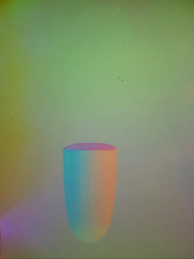

# TACSL-INSERTION-LAB-5090-20261007

已在 `brainco1-ThinkStation-P3-Tower-Gen-2`（192.168.10.252，RTX 5090）完成独立任务移植与运行/触觉/PPO 链路验证。使用 SSH 密钥连接，未把凭据写入文件。未更改本仓库现有机器人任务、共享控制代码、服务器 Isaac Lab 检出或其他作业。

服务器工程：`/home/brainco1/workspace/xinyu/tacsl_insertion_lab`。
本机审查镜像：[任务说明](/home/liuxinyu/workspace/tacsl-insertion-lab/README.md)、[差异清单](/home/liuxinyu/workspace/tacsl-insertion-lab/DIFFERENCES.md)。
运行解释器为既有 `assembly_play_sim6/bin/python`，Sim 6.0.1 / Lab 3.0.0 beta2 patch1 / RSL RL 5.0.1；[实际版本](runtime_versions.json)。

源为 IsaacGymEnvs/tacsl `f769e39fe5605324e0c6b3eb04ca7b8a7681f4e0`。保留原默认 YAML 的 Franka + 双 GelSight、6 维动作、14 维实际状态观测、控制公式、奖励、重置范围与 4 点平均距离 <0.0044958 m 的末步成功判据。不是 `train_state.sh` 的 AAC/full-state 配置。任务 ID 为 `TacSL-Task-Insertion-Original-v0`。

## 本次证据

- [数学契约](contract_validation.json)：10 方法 AST 一致；阈值内外、倒置、低于插孔侧向惩罚、动作尺度/零旋转通过。[控制库 AST](controller_ast_check.json)：14 函数、49 工具符号一致。
- [单环境 260 步](smoke_final.json)：观测/奖励/关节有限，完成一次 255 步超时及重置，0/1。
- [双侧触觉接触/释放](tactile_validation_01.json)：RGB、深度、法向/剪切均对接触有响应；释放后两侧力场均归零。左/右 RGB 平均变化 1.9371/1.7264（0–255），深度最大变化 0.7694/0.9896 mm。移离插销是单独传感器诊断，未计任务成功或训练样本。
- [PPO 4 次更新](ppo_03.json)：8 环境、8192 transitions、32 完整回合，0/32。[检查点审计](checkpoint_audit.json)：优化器 64 步，actor/critic 网络权重 L1 变化 50.5472/164.5944，模型/优化器/日志有限。
- [独立评测](eval_01.json)：新 seed 43，8 环境各 2 回合，**0/16**。短训练只验证链路，未学会插入。

## 重要差异与限制

1. 原始资产官方 Drive 下载要求登录；按用户“去下载”授权找到公开 ManiFeel 镜像补齐 4 OBJ/3 MTL。镜像机器人 URDF 与原版逐字节一致，哈希/URL 见 [provenance](provenance.json)；没有官方 zip 哈希，不能断言网格与官方包逐字节相同。
2. 新 PhysX / USD 导入和旧 Gym 数值不等价尚待验证，尤其 Jacobian 参考点、质量/惯量、执行器限幅、接触参数默认值。控制和奖励源公式一致不代表物理轨迹一致。
3. RTX 深度看见内壳导致触觉 RGB 常量；当前只隐藏两侧 housing **可视** Mesh，所有碰撞几何保留。外部视图也会缺这两个可视壳体。原校准、gel、相机位置及物体网格保持，但图像不宣称与旧 Gym 逐像素相同。
4. 触觉启用为独立输出，原默认 14 维状态策略不新增图像输入。小 PPO 用 RSL MLP，原 rl_games 为 LSTM；检查点不兼容，训练曲线不能公平对比。
5. 旧 Gym 专用二进制未运行；非默认 AAC/力观测/其他物体或 placement 变体未移植。保留非致命的 plug 子路径视图查询及 headless/TGS 警告。

全部失败和修复日志位于独立工程 `reports/`，没有覆盖。最终 checkpoint 为服务器 `reports/ppo_03/final.pt`，SHA256 `5a43ba98acdc71a4e80a0d034c019fc758959e92bd71159e8ad0688e70c9c372`。本次仿真/训练均已正常退出，GPU 结束核验为空闲。

## 修改影响和复现

原仓库 main/`167fc3c79fbf0c882fe85e3e3d8bb3f7d180f77e` 有大量用户已有改动，未覆盖。代码位于相邻新目录及服务器独立目录；本仓库仅增加证据与文档索引。
修改前 GitNexus：原 `compute_dof_torque` HIGH，已告知用户并只复制独立模块；新 env LOW、cfg MEDIUM。脚本/根文档图返回 UNKNOWN，补查动态注册、CLI 入口和 README/AGENTS/PROJECT_MAP/RUNBOOK 引用；图结果不当作低风险或无人使用证明。根文档仅前置本次导航，不更改旧结论/锚点；相关 impact JSON 在此目录。
未创建提交。复现命令和唯一输出目录要求见独立工程 README；不要使用旧 SSH 别名 `5090`，它对应另一台主机。
